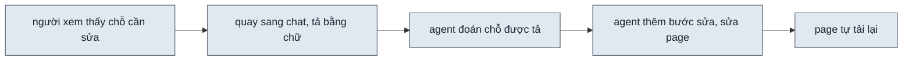
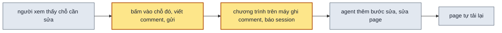

> **Nối tiếp:** [016](016-design-uiux-mo-page-trong-chrome.md) mở page trong Chrome ngay lúc dựng. Plan này giải cái
> 016 để hở: người xem thấy page nhưng muốn góp ý vẫn phải quay sang chat, tả bằng chữ chỗ cần sửa.
> **Phụ thuộc:** [016](016-design-uiux-mo-page-trong-chrome.md) xong trước. Hai plan cùng sửa lệnh tạo và mở page.

## 1. Problem

Người dùng xem page trong Chrome. Muốn sửa một chỗ, họ quay sang chat và tả bằng chữ: "cái thẻ thứ hai ở hàng trên, khổ
mobile, bản tối". Họ phải tự chép lại phương án, khổ màn, bộ dữ liệu đang xem. Agent đoán vị trí từ lời tả. Đoán sai
thì thêm một vòng góp ý. Session đang chạy skill có thể nằm trong terminal, trong VS Code hay trong một công cụ khác;
cách gửi góp ý không được chỉ chạy ở một chỗ.

## 2. Goal

- Trên thanh công cụ của page có nút bật chế độ comment. Trong chế độ đó, người xem bấm vào một khối hoặc kéo chọn một
  vùng, viết comment rồi bấm gửi.
- Comment gửi đi mang theo: page nào, phương án, khổ màn, sáng tối, bộ dữ liệu đang xem, khối hay vùng đã chọn, chữ
  trong khối đó.
- Khi session Claude Code đang chạy skill đang nghe comment, comment tới thì session tự thức dậy và sửa page, người
  dùng không gõ gì vào chat. Điều này đúng ở mọi nơi chạy Claude Code mà probe đã xác nhận.
- Khi không có session nào nghe, page báo "Claude không nghe" và có nút chép comment để dán vào chat. Lối này chạy
  với mọi công cụ.
- Mỗi comment có ghim trên page, ghim ghi trạng thái: đã gửi, đang sửa, đã sửa.
- Comment đã gửi mà chưa được sửa, vì session đang bận hay đã đóng, vẫn còn. Lần sau agent chạy skill trên thư mục đó
  thì sửa các comment này trước.

**Ngoài scope:** đăng page lên claude.ai hay bất kỳ dịch vụ ngoài nào. Hình vẽ tay. Trả lời qua lại trong một comment.
Nhiều người cùng comment một lúc.

## 3. Mental model

**Bây giờ chạy thế nào** — Agent giao page. Người dùng mở page trong Chrome, thấy một chỗ cần sửa. Họ quay sang chat, tả
chỗ đó bằng chữ và gõ góp ý. Agent đoán chỗ được tả, thêm một bước sửa vào danh sách bước dựng của page, sửa xong thì
page đang mở tự tải lại.



**Sau plan chạy thế nào** — Lúc giao, agent bật một chương trình nhỏ chạy trên máy, chỉ để nhận comment. Người xem bật
chế độ comment, bấm vào chỗ cần sửa, viết rồi gửi. Page gửi comment cho chương trình đó. Chương trình ghi comment vào
một file trong thư mục design rồi báo cho session. Session thức dậy, biết đúng chỗ người xem bấm, thêm bước sửa như
bây giờ. Nếu không có ai nghe, page cho chép comment để dán vào chat.



**Hành vi đổi ra sao:**

| #     | Tình huống | Bây giờ | Sau plan |
| ----- | ---------- | ------- | -------- |
| `BH1` | góp ý một chỗ cụ thể | tả bằng chữ trong chat | bấm vào chỗ đó trên page, viết, gửi; ghim hiện ở chỗ đó |
| `BH2` | session đang nghe comment | — | session tự thức dậy, ghim chuyển "đang sửa" rồi "đã sửa", page tự tải lại |
| `BH3` | không có session nào nghe | — | page báo "Claude không nghe", nút chép đưa comment kèm chỗ đã chọn vào bộ nhớ tạm |
| `BH4` | comment đã gửi nhưng session đóng trước khi sửa, sau đó agent chạy lại skill trên thư mục đó | — | agent sửa các comment còn tồn trước việc khác |
| `BH5` | một trang web khác trên máy gửi comment giả | — | comment bị bỏ, không thành bước sửa |
| `BH6` | người xem đang viết comment thì page có bản mới | page đợi con trỏ rời ô nhập mới tải lại | như bây giờ, ô comment cũng được tính là ô nhập |

**Không đụng:** cách dựng page, máy kiểm, design system, cách mở page trong Chrome.

---

## 4. Probe

### P1 — Trong Claude Code ở VS Code, một tiến trình nền in một dòng khi có comment có đánh thức được session đang rảnh không, và sau bao lâu?

**Biết để làm gì:** được thì comment tới là agent sửa ngay, không cần người dùng gõ gì. Không được thì chỉ còn lối chép
comment rồi dán vào chat.
**Cách chạy lại:** `.probe/017-design-uiux-comment-tren-page/P1-wake-vscode/README.md` (các bước làm trong một session
VS Code; script gửi comment là `send.mjs`)
**Kết quả:** được — 2026-10-12, Claude Code 2.1.296 trong VS Code, `P1-wake-vscode/probe.log`. Session đã kết thúc lượt,
không ai gõ gì. Comment gửi lúc 10:22:08, session thức dậy và chạy lệnh ghi giờ 3,7 giây sau, tính cả lúc model suy
nghĩ. Lệnh gửi chạy tách rời nên harness không theo dõi; chỉ dòng `comment` của Monitor đánh thức session. Không đo
cách lệnh nền thoát khi có comment đầu tiên: theo dõi từng dòng đã đủ, thêm cách thứ hai không đổi quyết định nào.

### P2 — Trong Claude Code ở terminal, cùng cách đó có đánh thức được session đang rảnh không?

**Biết để làm gì:** session chạy skill có thể là terminal. Nếu terminal không thức dậy, thì lối tự động chỉ hứa được cho
VS Code.
**Cách chạy lại:** `python3 .probe/017-design-uiux-comment-tren-page/P2-wake-terminal/probe.py` (chạy `claude` có
khung tương tác trong một pseudo-terminal, gửi comment, đọc file session ghi khi thức)
**Kết quả:** được — 2026-10-12, Claude Code 2.1.296, khung tương tác trong pseudo-terminal 120×40, `P2-wake-terminal/probe.log`,
màn hình cuối ở `screen.txt`. Session trả lời "đã bật", về dấu nhắc với dòng "1 monitor still running", rảnh 10 giây.
Comment tới thì màn hình hiện "Monitor event: comment…", session chạy lệnh ghi giờ 2,8 giây sau khi gửi. Lần chạy đầu
dừng ở hộp hỏi tin cậy thư mục; probe chọn tin cậy gốc repo rồi chạy lại.

### P3 — Claude Code chạy một lượt (`claude -p`, giống cách Agent SDK hay CI gọi) có còn sống để nhận comment sau khi trả lời xong không?

**Biết để làm gì:** nếu không, thì lối tự động không áp được cho cách chạy một lượt, và lượt chạy thử `--auto` phải
kiểm phần nhận comment bằng cách khác.
**Cách chạy lại:** `node .probe/017-design-uiux-comment-tren-page/P3-print-mode/probe.mjs`
**Kết quả:** được — 2026-10-12, Claude Code 2.1.296, `P3-print-mode/probe.log`. `claude -p` in "đã bật" nhưng không thoát:
còn Monitor chạy thì tiến trình còn sống. Sau 60 giây chờ, comment tới, session chạy lệnh ghi giờ 2,8 giây sau khi gửi.
Hệ quả: lượt chạy một lượt nào bật nghe sẽ không thoát cho tới khi Monitor hết hạn.

### P4 — Page mở bằng `file://` trong Chrome có gửi được comment tới một chương trình nghe ở `127.0.0.1` không?

**Biết để làm gì:** Chrome có luật chặn trang gọi vào địa chỉ nội bộ. Bị chặn thì chương trình nghe phải phục vụ luôn
page qua `http://127.0.0.1`, và link `file://` mọi chỗ khác của skill phải đổi.
**Cách chạy lại:** `node .probe/017-design-uiux-comment-tren-page/P4-file-fetch/probe.mjs` (Chrome headless, profile tạm)
**Kết quả:** được — 2026-10-12, Chrome 154.0.8037.98, macOS 26.5.1, `P4-file-fetch/probe.log`. Cả Chrome headless profile
tạm lẫn Chrome thật mở bằng `open -na` profile dùng gần nhất: `GET /health` 200, `POST /comment` 201, không hộp hỏi
quyền nào. Request mang `Origin: null`.

## 5. Decisions

**Ai quyết:** 🤖 = agent tự quyết, chưa hỏi ai — **chỗ người duyệt phải soi** · 👤 = user chốt lúc bàn (luật 22).

### D0 👤 — Mọi thứ chạy trên máy; skill không đăng page hay comment lên dịch vụ ngoài nào

**Lý do:** skill độc lập, page có thể chứa thiết kế của khách.
**Phương án đã loại:** đăng page thành Claude Artifact để dùng sẵn comment và "Send to Claude" của claude.ai.

### D1 👤 — Cách gửi comment không phụ thuộc một nơi chạy session: terminal, VS Code hay công cụ khác

**Lý do:** người dùng chạy skill ở nhiều nơi. Lối chép rồi dán chạy ở mọi nơi; lối tự động chỉ hứa cho nơi probe đã
xác nhận → DS5.

### D2 🤖 — Page vẫn mở bằng `file://`; riêng comment gửi tới chương trình nghe ở `127.0.0.1`

**Lý do:** dựa vào `P4`. Link `file://` của 016 và mọi lệnh khác giữ nguyên.
**Phương án đã loại:** chương trình nghe phục vụ luôn page. Cách này đổi mọi link, và page không mở được khi chương
trình tắt.

### D3 🤖 — Chương trình nghe là lệnh mới `new-design.mjs listen`; mỗi comment một dòng JSON ra stdout

**Lý do:** dựa vào `P1` · `P2`. Một dòng stdout là thứ công cụ theo dõi tiến trình nền của Claude Code đọc được. Lệnh
dùng `node:http`, không cài thêm gì → DS3 · DS4.
**Phương án đã loại:** page ghi thẳng ra đĩa. Page `file://` không ghi được file.

### D4 🤖 — `comments.json` trong thư mục design là nơi lưu chính; stdout chỉ để đánh thức

**Lý do:** dựa vào `P3`. Session có thể không còn sống lúc comment tới; comment vẫn phải còn cho lần chạy sau → DS1.

### D5 👤 — Mỗi comment thành một bước `Góp ý:` qua `progress --round` có sẵn

**Lý do:** vòng góp ý hiện nay (`F4.4`) đã có danh sách bước, nhãn tiến độ, tự tải lại. Comment tới lúc agent đang sửa
thì vào vòng kế.
**Đổi (2026-10-12):** mỗi comment một vòng riêng; comment tới khi đang có vòng thì chờ vòng đó giao xong — Andy thử
trên 076: SKILL.md lúc đó cho `--insert` comment #2 vào vòng của #1, ghim #1 đứng "đang sửa" dù đã sửa xong.

### D6 🤖 — Chương trình nghe tạo một token mỗi lần bật; comment thiếu token thì bị bỏ

**Lý do:** mọi trang web đang mở trên máy đều gọi được `127.0.0.1`. Page đọc token và cổng từ `_listen.js` trong thư mục
design → DS4.

### D7 🤖 — Agent ngừng nghe khi người dùng nói xong; lượt `--auto` không bật nghe

**Lý do:** dựa vào `P3`: lượt một lượt bật nghe thì không thoát tới khi Monitor hết hạn. Lượt chạy thử không có người
xem; nghiệm thu giả lập người bấm gửi bằng một request tới chương trình nghe.

## 6. Design

### DS1 — Dạng comment

`<thư mục design>/comments.json` là một mảng; `comments.js` là bản sao cho page đọc (`window.DS_COMMENTS = […]`).

| field | kiểu | ghi chú |
| --- | --- | --- |
| `id` | số | tăng dần trong thư mục design, cũng là số trên ghim |
| `page` | chuỗi | tên file page |
| `url` | chuỗi | query string lúc gửi: phương án, khổ màn, sáng tối, variables, tweaks |
| `target.kind` | `element` · `area` | bấm một khối hay kéo một vùng |
| `target.selector` | chuỗi | selector của khối; `area` thì là khối nhỏ nhất chứa cả vùng |
| `target.text` | chuỗi | tối đa 200 ký tự chữ trong khối |
| `target.rect` | `{x,y,w,h}` | theo toạ độ page, đơn vị px |
| `body` | chuỗi | chữ người xem viết |
| `status` | `sent` → `doing` → `done` | lệnh `listen` ghi `sent`; agent đổi bằng `comment --status` |
| `at` | ISO 8601 | lúc gửi |

Mọi lần ghi là ghi file tạm rồi đổi tên, như `.progress.js`.

### DS2 — Overlay comment trong `shell.js`

| Phần | Hành vi |
| --- | --- |
| nút bật | trong view-controller; bật thì con trỏ thành dấu cộng, các nút của page tạm không bấm được |
| chọn khối | rê chuột thì khối dưới con trỏ có viền; bấm thì chọn khối đó |
| chọn vùng | kéo chuột vẽ hình chữ nhật |
| popover | ô viết, nút Gửi, nút Chép, nút Huỷ; ô viết được tính là ô nhập để page không tự tải lại giữa chừng (`F6.4`) |
| ghim | số `id`, màu theo `status`; đọc `comments.js` mỗi 2 giây cùng nhịp đọc `.progress.js` |
| khổ tablet / mobile | overlay chạy trong iframe, gửi ra trang cha bằng `postMessage` như toolbar đang làm |
| không ai nghe | đọc `_listen.js` lỗi hay `GET /health` lỗi thì popover ghi "Claude không nghe", nút Gửi tắt, nút Chép còn |
| màn ≤ 480px | không có nút comment: toolbar 375px không đủ chỗ. Khổ mobile vẫn comment được trên màn rộng, trong khung mobile |
| phím | Cmd/Ctrl+Enter gửi; Esc đóng ô viết, Esc lần nữa thoát chế độ comment |

**Đổi (2026-10-12):** thêm hai dòng "màn ≤ 480px" và "phím" — `test-shell.mjs` báo toolbar 375px tràn 11px khi có nút
comment, và Esc không đóng ô viết khi con trỏ ở nút.

Nút Chép đưa vào bộ nhớ tạm một khối chữ: `Comment trên <page> (<url>): khối "<text>" <selector> — <body>`.

### DS3 — CLI Surface

```bash
node $SKILL/scripts/new-design.mjs listen  <thư mục design>                 # chạy tới khi bị tắt
node $SKILL/scripts/new-design.mjs comment <thư mục design> --pending       # in comment status sent, mỗi cái một dòng JSON
node $SKILL/scripts/new-design.mjs comment <thư mục design> --status <id> doing|done
```

- `listen`: chọn cổng trống, ghi `_listen.js` (`window.DS_LISTEN = {port, token}`), in `listen <port>` rồi mỗi comment
  một dòng `comment {json}`. Thoát thì xoá `_listen.js`. Exit 2 khi thư mục design sai.
- `comment --status` ghi lại `comments.json` và `comments.js`.
- Cả hai ghi một dòng `run.log`.

### DS4 — HTTP

```http
GET  /health                → 200 "ok"
POST /comment  (text/plain, JSON trong body, có token)
     201 → {"id": 3}
     403 → token sai hay thiếu
```

- Chỉ nghe trên `127.0.0.1`.
- Mọi phản hồi có `Access-Control-Allow-Origin: *`; body `text/plain` để Chrome không gửi request kiểm trước.

### DS5 — Luật trong SKILL.md

| Mục SKILL.md | Thêm gì |
| --- | --- |
| Danh sách lệnh | `listen`, `comment` |
| Bước 6, ngay sau tin giao | nếu không `--auto` và nơi chạy có công cụ theo dõi tiến trình nền, thì bật `listen` bằng công cụ đó; tin giao nói người xem bấm nút comment để góp ý |
| Vòng sau, mục mới "Comment trên page" | mỗi comment một vòng `--round` riêng; comment tới khi đang có vòng thì chờ (`F7.10`); `--status doing` lúc mở vòng, `done` ngay sau `--delivered` của vòng đó; công cụ theo dõi hết hạn thì bật lại; người dùng nói xong thì tắt |
| Bước 1 | thư mục design đã có: chạy `comment --pending`, có comment thì sửa trước |
| Lối chép rồi dán | người dùng dán khối chữ của nút Chép vào chat thì xử lý như một comment |

Câu lệnh theo dõi cụ thể theo kết quả `P1` · `P2`.

### DS6 — Test Strategy

| File | Vai |
| --- | --- |
| `scripts/test-listen.mjs` | bật `listen` trên thư mục design tạm, gửi request, so `comments.json` và stdout |
| `check.mjs --quick` có cờ bấm | bật chế độ comment, bấm một khối, kiểm popover và payload |

| Ca | Đầu vào | Mong đợi |
| --- | --- | --- |
| L1 | `POST /comment` đúng token | 201; stdout một dòng `comment`; `comments.json` thêm một mục `sent` |
| L2 | `POST /comment` sai token | 403; `comments.json` không đổi |
| L3 | `comment --status 1 done` | `comments.js` có `status: "done"` |
| L4 | tắt `listen` | `_listen.js` không còn |
| L5 | `--pending` sau L1 | một dòng; sau L3 thì không dòng nào |

## 7. Phases

**Legend:** 🤖 = agent tự kiểm được (chạy lệnh, test, grep) · 👤 = cần người kiểm (số đo thật, UI, hạ tầng).

- [x] 👤 plan này được duyệt — 2026-10-12, Andy: "trước hết implement plan để tôi kiểm tra hoạt động thực tế trước"

### Phase 0 — ghi doc nguồn

**Goal:** SPEC có scope comment trên page; mục 017 trong PLANS.md ở `approved`.
**Cover:** —

**Actions:**

- [x] 🤖 SPEC: scope `F7` Comment trên page, sub-scope theo EARS (D0 · D1) — 2026-10-12, `F7.1`–`F7.9`: chọn khối hay vùng, nội dung comment, gửi tới lệnh nghe trên máy, không ai nghe thì chép, session thức dậy và sửa, ghim, comment còn tồn, token, bật nghe lúc giao
- [x] 🤖 SPEC §3: một phần technical design cho chương trình nghe và overlay — 2026-10-12, §3.7, bảng phần §3, bảng file §3.1, §4 Vòng góp ý, §5
- [x] 🤖 PLANS.md: mục `017` lên `approved`, bảng mã `F7.x` `new` — 2026-10-12

**Gate:**

- [x] 🤖 `node scripts/spec-check.mjs skills/design-uiux` liệt kê các `F7.x` mới là chưa có mục SKILL.md, không lỗi nào khác — 2026-10-12: 9 dòng "chưa có trong SKILL.md", 9 dòng "chưa có trong PLANS.md" trước khi PLANS.md lên `approved`
- [x] 🤖 `python3 ~/.claude/skills/write-plan/verify.py .plan/017-design-uiux-comment-tren-page.md` — 0 ERROR — 2026-10-12

### Phase 1 — comment rồi chép

**Goal:** người xem comment được trên page và chép ra để dán vào chat; chưa cần chương trình nghe.
**Cover:** DS2

**Actions:**

- [x] 🤖 `shell/shell.js`, `shell/shell.css`: overlay theo DS2, cả trong iframe khổ mobile — 2026-10-12; `references/shell-principles.md` thêm mục "Chế độ comment"
- [x] 🤖 `check.mjs`: không báo lỗi khi shell nạp `comments.js`, `_listen.js` không có — 2026-10-12, regex `ofProgress`. Chế độ comment tắt mặc định nên lượt bấm của `check.mjs` không cần bật nó

**Gate:**

- [x] 🤖 `test-shell.mjs` trên page mẫu: bấm một khối ra popover, khối chữ của nút Chép có page, query, `selector`, chữ của khối, góp ý — DS2 · BH1 · BH3 — 2026-10-12: `Comment trên 01-forecast.html · khối 1 \`#design > div:nth-of-type(1) > section:nth-of-type(1) > div > h1\` "Thành viên": tiêu đề ngắn lại`
- [x] 🤖 khổ mobile (màn 1280px, khung mobile): bấm một khối trong iframe ra ô viết nằm trong khung, gửi ghi `viewport` mobile — DS2 — 2026-10-12: `?viewport=mobile&theme=dark`; màn 375px không có nút comment
- [x] 🤖 `test-shell.mjs`, `test-progress.mjs` vẫn exit 0 — 2026-10-12: test-shell exit 0, 87 ✓; test-progress, test-new-design, test-open exit 0; `check.mjs --quick` trên page 076 0 lỗi
- [x] 👤 mở page thật, bật comment, chọn khối và vùng, thấy ghim — 2026-10-12, Andy trên page 076 trong Chrome: comment #1 chọn khối "Bây giờ 10:30", #2 chọn khối 4 (bảng)

### Phase 2 — gửi tự động

**Goal:** comment gửi từ page thành bước sửa trong session đang nghe.
**Cover:** DS1 · DS3 · DS4 · DS5 · DS6

**Actions:**

- [x] 🤖 `new-design.mjs`: lệnh `listen`, `comment`, `run.log` (D2 · D3 · D4 · D6) — 2026-10-12; thêm: lệnh nghe thứ hai trên cùng thư mục exit 1
- [x] 🤖 `scripts/test-listen.mjs`: ca L1–L5; `// spec:` ở đầu file — 2026-10-12, thêm L0 (health) và L6 (lệnh nghe thứ hai)
- [x] 🤖 `shell.js`: nút Gửi, đọc `_listen.js`, ghim theo `comments.js` — 2026-10-12
- [x] 🤖 SKILL.md: các chỗ theo DS5, mỗi mục có dòng `<!-- spec: … -->` (D5 · D7) — 2026-10-12: bảng file, danh sách lệnh, bảng `--auto`, view-controller, tin giao mục 9, mục "Nghe comment", đầu "Vòng sau", mục "Comment trên page"

**Gate:**

- [x] 🤖 `node skills/design-uiux/scripts/test-listen.mjs` exit 0, L1–L5 ✓ — DS1 · DS3 · DS4 · DS6 · BH5 — 2026-10-12: 12 ✓, sai hay thiếu token → 403, `comments.json` không đổi
- [x] 🤖 `node scripts/spec-check.mjs skills/design-uiux` 0 lỗi; `--matrix` cho mỗi `F7.x` một mục SKILL.md — DS5 — 2026-10-12: `✓ 74 sub-scope`
- [x] 🤖 `test-shell.mjs` trên page mẫu có `listen` đang chạy: bấm Gửi thì `comments.json` thêm một mục — DS2 · DS4 — 2026-10-12: 3 mục (khối, vùng, khổ mobile), stdout lệnh nghe có dòng `comment`

### Phase 3 — nghiệm thu

**Goal:** mỗi bullet §2 có bằng chứng từ một lượt chạy thật.
**Cover:** —

Lượt chạy thử luôn `--auto` và không bật nghe. Phần tự thức dậy chỉ kiểm được trong session có người, theo đúng nơi
chạy mà probe đã xác nhận.

**Actions:**

- [x] 🤖 chạy bài `04-quick-screen` `--auto` từ `prepare.mjs`, slug `nghiem-thu-017` — 2026-10-12: `.test/design-uiux/077-sample-04-quick-screen-nghiem-thu-017/`, 736 giây, 44 tool_use, 0 `Monitor`, 0 `listen`, 0 AskUserQuestion; tin giao có hướng dẫn nút comment và nói `--auto` nên không bật lệnh nghe
- [x] 🤖 trên thư mục design đó: bật `listen`, gửi comment bằng request như page gửi, rồi `claude -p --resume` để agent xử lý — 2026-10-12: `pending.mjs`, POST 201, tắt lệnh nghe, resume với câu "Mở lại thư mục design vừa giao để sửa tiếp, vẫn chạy --auto."
- [x] 👤 trong một session có người: mở page, comment một khối, xem session tự sửa — 2026-10-12, Andy trên 076, session VS Code này: #1 tới 10:50:26, session thức và sửa; #2 tới giữa vòng của #1

**Gate:**

- [x] 🤖 §2 bullet 1: `test-shell.mjs` bấm nút comment, chọn khối, popover hiện; kéo chọn vùng — BH1 — 2026-10-12, 87 ✓
- [x] 🤖 §2 bullet 2: mục trong `comments.json` có đủ field DS1, `url` khớp giá trị đang xem — BH1 — 2026-10-12: comment #1 của Andy `url` `?sections=1` (đang bật số khối), mobile `?viewport=mobile&theme=dark`
- [x] 👤 §2 bullet 3: session tự thức, ghim "đang sửa" rồi "đã sửa", page tự tải lại — BH2 · BH6 — 2026-10-12: Andy gửi #1, #2 từ Chrome; session thức từ dòng `comment` của Monitor; cả hai `done`. Andy thấy #1 đứng "đang sửa" vì #2 bị chèn vào vòng của #1 → D5 đổi, `F7.10`
- [x] 🤖 §2 bullet 4: tắt `listen`, page báo "Claude không nghe", nút Chép còn — BH3 — 2026-10-12, `test-shell.mjs`: nút Gửi tắt, nút Chép đưa `Comment trên 01-forecast.html · khối 1 …: tiêu đề ngắn lại`
- [x] 🤖 §2 bullet 5: ghim hiện "đã gửi" khi comment vừa tới — BH2 — 2026-10-12, `test-shell.mjs`: ghim #1 `sent`, đổi `doing` trong 2 giây sau `--status`
- [x] 🤖 §2 bullet 6: comment ở `sent` khi session đóng; lượt `--resume` sau sửa nó trước, ghim "đã sửa" — BH4 — 2026-10-12, 077 `resume.stream.jsonl`: tool_use đầu là `comment --pending`, rồi `--status 1 doing`, vòng 2 "Comment #1: …", `comments.json` #1 `done`, 96 giây
- [x] 🤖 `python3 ~/.claude/skills/write-plan/verify.py .plan/017-design-uiux-comment-tren-page.md` — 0 ERROR — 2026-10-12
