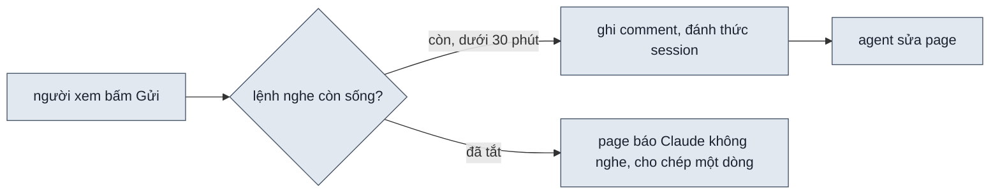
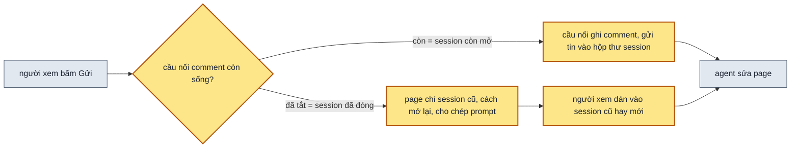
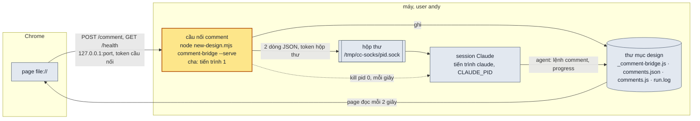
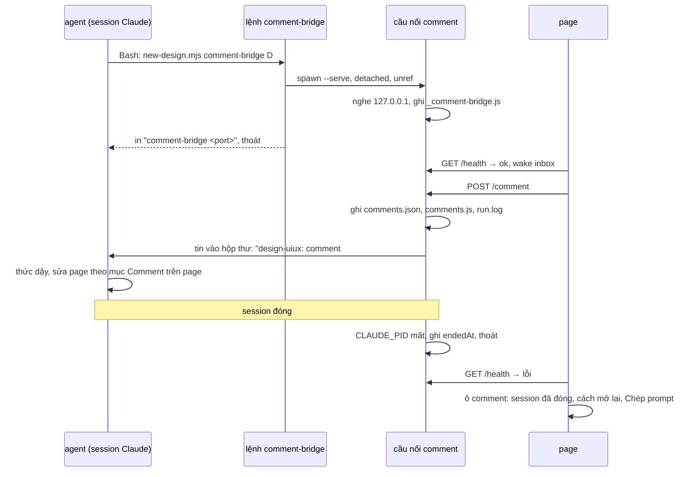

> **Nối tiếp:** [017](017-design-uiux-comment-tren-page.md) cho người xem comment trên page và gửi về session đang
> chạy skill. Plan này giải cái 017 để hở: lệnh nghe comment chỉ sống 30 phút một lượt, và khi không ai nghe thì page
> không nói người xem phải làm gì.
> **Lật:** D3 · D7 của [017](017-design-uiux-comment-tren-page.md). **Giữ:** D0 · D1 · D2 · D4 · D6.

## 1. Problem

Lúc giao page, agent bật lệnh nghe comment, nhưng lệnh này chỉ sống tối đa 30 phút một lượt. Hết 30 phút, agent phải
tốn một lượt chạy model để bật lại; agent dừng bật lại sau hai lượt không có comment. Ngày 2026-10-14 Andy mở page lịch
hẹn của lượt 076 để comment và gặp "Claude không nghe: chép rồi dán vào chat", dù session vẫn mở trong VS Code. Dòng đó
không nói dán vào đâu, session nào, session còn mở hay đã đóng. Dòng chép ra chỉ tả chỗ được chọn; dán vào một session
mới thì session đó không biết design nào, không bật lại nghe. Ba lệnh nghe do test bật từ ngày 12/10 vẫn còn chạy trên
máy.

## 2. Goal

- Khi session Claude Code chạy skill còn mở, page gửi được comment bất kể session đã ngồi yên bao lâu. Session thức dậy
  và sửa page, người xem không gõ gì vào chat.
- Khi agent đang sửa một comment, comment mới vẫn gửi được, ghim ghi "đã gửi", agent sửa ngay sau comment đang làm.
- Khi session đã đóng, ô comment ghi session đó chạy ở đâu (VS Code hay terminal), mã session, cách mở lại, và có nút
  "Chép prompt".
- Khi người xem dán prompt đó vào session cũ đã mở lại, hay vào một session Claude Code mới mở ở thư mục dự án, agent
  sửa page theo comment, comment có số và ghim, rồi agent bật lại cầu nối comment.
- Khi session đóng, cầu nối comment của nó tắt theo. Chạy test xong không còn cầu nối comment nào sót trên máy.

**Ngoài scope:** tự mở lại session đã đóng khi có comment. Công cụ khác Claude Code tự thức dậy khi có comment: ở đó
comment vẫn được lưu và ô comment chỉ người xem gõ gì vào chat.

## 3. Mental model

**Bây giờ chạy thế nào** — Agent giao page rồi bật lệnh nghe dưới công cụ theo dõi của Claude Code. Lệnh nghe vừa nhận
comment vừa đánh thức session. Công cụ theo dõi tắt lệnh nghe sau 30 phút. Agent bật lại được, nhưng mỗi lần bật lại là
một lượt chạy model, nên sau một giờ không có comment agent để nó tắt. Từ lúc đó page báo "Claude không nghe", comment
không gửi được, người xem chép một dòng tả chỗ rồi tự tìm chỗ dán. Session đóng thì cũng y như vậy.



**Sau plan chạy thế nào** — Lệnh nghe được thay bằng **cầu nối comment**: một chương trình nhỏ chạy song song với
session Claude, như một tiến trình riêng của máy. Claude Code không quản lý nó, nên không có gì cắt nó sau 30 phút. Cầu
nối làm ba việc:

1. Nhận comment từ page.
2. Gửi tin vào hộp thư của session. Mỗi session Claude Code có sẵn một hộp thư trên máy; tin vào là session thức dậy,
   như khi người dùng gõ một câu.
3. Canh session: mỗi giây hỏi máy xem session còn chạy không. Session đóng thì cầu nối tắt theo.

Nhờ việc thứ ba, page chỉ cần hỏi cầu nối còn sống không là biết session còn mở hay đã đóng. Còn thì page gửi comment.
Không còn thì page đọc thông tin session cũ mà cầu nối ghi lúc bật, chỉ cách mở lại, và cho chép một prompt đủ để
session cũ hay mới làm tiếp.



**Hành vi đổi ra sao:**

| #     | Tình huống | Bây giờ | Sau plan |
| ----- | ---------- | ------- | -------- |
| `BH1` | session mở nhưng ngồi yên hơn một giờ, người xem comment | "Claude không nghe", phải chép rồi tự dán | gửi được; session thức dậy và sửa |
| `BH2` | comment khi agent đang sửa comment khác | gửi được, agent sửa sau | như bây giờ |
| `BH3` | session đã đóng | "Claude không nghe: chép rồi dán vào chat" | ô ghi session cũ chạy ở VS Code hay terminal, mã session, cách mở lại; nút "Chép prompt" |
| `BH4` | dán phần đã chép vào một session mới | session mới chỉ thấy một dòng tả chỗ, không biết design nào, không bật nghe | agent ghi comment có số, sửa page, bật lại cầu nối comment |
| `BH5` | page chưa từng có cầu nối (lượt chạy tự động, design cũ) | "Claude không nghe" | ô ghi chưa có session nào nhận comment của page này; nút "Chép prompt" để dán vào session mới |
| `BH6` | chạy test của skill xong | lệnh nghe test bật có thể còn chạy mãi | không còn cầu nối comment nào sót |
| `BH7` | session không có hộp thư (Claude Code tắt tính năng này, hay công cụ khác) | "Claude không nghe" nếu không có lệnh nghe | comment gửi được và được lưu; ô bảo người xem gõ "xem comment" vào session |

**Không đụng:** cách chọn khối, viết comment, ghim; danh sách góp ý trên toolbar; cách agent sửa page theo comment.

---

## 4. Probe

Mỗi session Claude Code có sẵn một hộp thư trên máy: biến môi trường `CLAUDE_CODE_MESSAGING_SOCKET` (một Unix socket
`/tmp/cc-socks/<pid>.sock`) và `CLAUDE_CODE_MESSAGING_TOKEN`. Log gỡ lỗi của Claude Code 2.1.296 ghi cách gửi tin vào:
một dòng JSON `{"type":"auth","token":…}` rồi một dòng `{"type":"user","message":{"role":"user","content":…}}`. Hai
biến này, cùng `CLAUDE_PID`, `CLAUDE_CODE_SESSION_ID`, `CLAUDE_CODE_ENTRYPOINT`, có trong môi trường của lệnh Bash mà
session chạy (đã thấy trong session VS Code của plan này). Các probe dùng một chương trình thử `start.mjs` đóng vai cầu
nối comment.

### P1 — Một chương trình tách rời do session bật, gửi tin vào hộp thư của session, có đánh thức session đang nghỉ không, ở terminal và ở VS Code?

**Biết để làm gì:** được thì cầu nối comment tự đánh thức session mỗi khi có comment, không cần công cụ theo dõi nào,
không có hạn 30 phút. Không được thì phải dùng lệnh chờ chạy nền ở P2, hay giữ cách bật lại 30 phút một lần.
**Cách chạy lại:** `python3 .probe/020-design-uiux-nghe-comment-suot-session/P1-inbox/probe.py` (terminal, chạy `claude`
có khung tương tác trong một pseudo-terminal); bước VS Code ở `P1-inbox/README.md`
**Kết quả:** được — 2026-10-14.
- Terminal, Claude Code 2.1.299, `P1-inbox/probe.log`: session nghỉ 10 giây, tin tới thì session chạy lệnh ghi giờ
  4,3 giây sau khi gửi. Session đang chạy một lệnh 25 giây ở tiền cảnh thì tin không mất: session xử lý tin 3,3 giây
  sau khi lệnh xong.
- VS Code, Claude Code 2.1.296, `P1-inbox/vscode.log`: chính session viết plan này, đã kết thúc lượt, không ai gõ gì.
  Tin tới, session thức dậy và chạy lệnh ghi giờ 4,9 giây sau khi gửi.
- Session hiện tin với lời dẫn "Another Claude session sent a message", kèm lời dặn coi đó là yêu cầu của một session
  khác, không phải của người dùng. Hộp thư không trả gì về cho bên gửi.
- Chương trình tách rời có cha là tiến trình 1: lệnh bật nó thoát rồi nó vẫn chạy.

### P2 — Lệnh chạy nền bằng Bash (`run_in_background`) có sống quá 30 phút không, và khi nó thoát thì session đang nghỉ có thức dậy không?

**Biết để làm gì:** là đường dự phòng khi hộp thư ở P1 không dùng được: lệnh chờ chạy nền thoát khi có comment, session
thức dậy, agent bật lệnh chờ mới.
**Cách chạy lại:** chưa viết.
**Kết quả:** không chạy — 2026-10-14, P1 được ở cả terminal lẫn VS Code.

### P3 — Chương trình tách rời do session bật có biết lúc session đóng không?

**Biết để làm gì:** cầu nối comment sống tới khi session đóng thì phải thấy được lúc đó, để tắt và để page phân biệt
"session còn mở" với "session đã đóng". Không thấy được thì cầu nối phải tắt theo giờ, page không chỉ đường đúng được.
**Cách chạy lại:** terminal đo cùng lượt với P1 (`P1-inbox/probe.py` gõ `/exit` ở cuối); bước VS Code (đóng tab) ở
`P3-session-end/README.md`
**Kết quả:** terminal được; phần VS Code chuyển sang Gate nghiệm thu, Andy duyệt plan khi phần này chưa đo — 2026-10-14, Claude Code 2.1.299, dòng `P3 terminal:` trong
`P1-inbox/probe.log`. `CLAUDE_PID` là tiến trình `claude` của chính session ở cả terminal lẫn VS Code. Gõ `/exit`,
khung tương tác hỏi có dừng lệnh nền không (chương trình tách rời không có trong danh sách lệnh nền), chọn thoát;
chương trình tách rời thấy `CLAUDE_PID` mất khoảng 1 giây sau và tự tắt. Phần VS Code chờ Andy đóng một tab.

### P4 — Mã session lấy từ biến môi trường có mở lại được bằng `claude --resume <mã>` không, kể cả session tạo trong VS Code?

**Biết để làm gì:** được thì ô comment ghi thẳng lệnh mở lại cho người xem. Không được thì ô chỉ ghi "mở lại session cũ
trong VS Code hay terminal".
**Cách chạy lại:** `node .probe/020-design-uiux-nghe-comment-suot-session/P4-resume/probe.mjs` (mở lại bằng
`--fork-session` để session gốc không bị ghi thêm)
**Kết quả:** được — 2026-10-14, Claude Code 2.1.299, `P4-resume/probe.log`. Session tạo bằng `claude -p` mở lại theo mã
và nhớ từ khoá đã dặn. Session tạo trong VS Code mở lại từ terminal theo mã, model trích được câu đầu của cuộc trò
chuyện đó.

## 5. Decisions

**Ai quyết:** 🤖 = agent tự quyết, chưa hỏi ai — **chỗ người duyệt phải soi** · 👤 = user chốt lúc bàn (luật 22).

### D0 👤 — Ô comment nói người xem phải làm gì trong từng trạng thái của cầu nối comment

**Lý do:** "Claude không nghe: chép rồi dán vào chat" không nói dán vào đâu. Ô ghi lệnh mở lại session cũ theo `P4` →
DS1.

### D1 👤 — Khi không có cầu nối, ô comment cho chép một prompt dán được vào session cũ lẫn session mới

**Lý do:** người xem có thể không nhớ session cũ nằm ở đâu. Prompt mang thư mục design, page, chỗ chọn, comment, và yêu
cầu bật lại cầu nối → DS3.

### D2 🤖 — Cầu nối comment là một tiến trình chạy riêng, tách khỏi Claude Code, sống tới khi session đóng

**Lý do:** công cụ theo dõi của Claude Code giết lệnh con sau 30 phút. Tiến trình tách riêng (cha là tiến trình 1)
không nằm dưới tool nào nên không bị đếm giờ. Cầu nối tự canh `CLAUDE_PID` để tắt theo `P3` → DS6.
**Phương án đã loại:** bật lại công cụ theo dõi mãi mãi: mỗi 30 phút một lượt chạy model đọc lại cả cuộc trò chuyện.

### D3 🤖 — Cầu nối comment đánh thức session bằng cách gửi một tin vào hộp thư của session

**Lý do:** dựa vào `P1`: thức dậy sau 4–5 giây ở terminal và VS Code, không hạn giờ, không tốn lượt model khi không có
comment. Tin tới lúc session bận thì chờ, không mất → DS2 · DS6.
**Phương án đã loại:** lệnh chờ chạy nền thoát khi có comment (`P2`, không cần chạy); bật lại công cụ theo dõi 30 phút
một lần.

### D4 🤖 — Cầu nối ghi thông tin session vào `_comment-bridge.js` lúc bật và không xoá file khi tắt; page hỏi `/health` để biết cầu nối còn sống

**Lý do:** cầu nối tắt khi session đóng (D2), nên "cầu nối chết" nghĩa là "session đã đóng". Page cần mã session, nơi
chạy, thư mục dự án để chỉ đường, kể cả sau khi cầu nối đã tắt → DS1 · DS2.

### D5 🤖 — Agent nhận prompt chép từ page thì ghi comment vào `comments.json` bằng `comment --add` trước khi sửa

**Lý do:** comment có số và ghim như comment gửi thẳng; danh sách góp ý trên toolbar không cần nhánh riêng → DS3 · DS4.

### D6 🤖 — Test nào bật cầu nối comment thì tắt nó cả khi test hỏng giữa chừng

**Lý do:** ba lệnh nghe do `test-shell.mjs` bật từ 12/10 còn chạy tới 14/10 → DS5.

### D7 🤖 — Nếu session không có hộp thư, thì cầu nối vẫn nhận và lưu comment, ô comment bảo người xem gõ vào session

**Lý do:** hộp thư là tính năng nội bộ của Claude Code, chưa có tài liệu, có công tắc bật tắt; công cụ khác không có.
Comment đã lưu thì agent đọc bằng `comment --pending` khi người xem nhắn → DS1 · DS6.

### D8 👤 — Chương trình gọi là cầu nối comment: lệnh `comment-bridge`, file `_comment-bridge.js`; "lệnh nghe" và `listen` bỏ

**Lý do:** nó làm ba việc: nhận comment, gửi vào session, tắt khi session đóng để page biết session đã đóng. "Lệnh nghe"
chỉ nói việc đầu. "Monitor" trùng tên tool của Claude Code → DS2.

## 6. Design

### DS6 — Kiến trúc cầu nối comment

Cầu nối comment là một tiến trình Node chạy song song với tiến trình `claude` của session. Hai tiến trình độc lập: cầu
nối không phải tiến trình con của session, Claude Code không thấy nó, không đếm giờ nó, `/exit` không hỏi về nó.



**Ba việc:**

| Việc | Kênh | Bảo vệ |
| --- | --- | --- |
| nhận comment từ page | HTTP trên `127.0.0.1`, cổng trống bất kỳ | token của cầu nối trong `_comment-bridge.js` (017 D6) |
| gửi tin vào session | Unix socket `CLAUDE_CODE_MESSAGING_SOCKET` | `CLAUDE_CODE_MESSAGING_TOKEN`; chỉ tiến trình do session bật mới có; socket quyền `srw-------` |
| canh session | `process.kill(CLAUDE_PID, 0)` mỗi giây | — |

Session không gọi ngược vào cầu nối. Agent đọc và ghi comment qua file, bằng lệnh `comment` (`--pending`, `--status`,
`--add`).

**Vòng đời:**



1. **Bật:** agent chạy `comment-bridge` bằng Bash thường, không `run_in_background`, không `Monitor`. Lệnh bật một bản
   sao `--serve` tách riêng (`detached`, `stdio: "ignore"`, `unref`), chờ bản sao ghi `_comment-bridge.js` và trả lời
   `/health` (tối đa 5 giây), in `comment-bridge <port>`, thoát 0.
2. **Chạy:** bản sao nghe HTTP, nhận comment, gửi tin vào hộp thư.
3. **Tắt:** khi `CLAUDE_PID` mất (≈1 giây sau khi session đóng, `P3`), hay khi nhận SIGTERM/SIGINT/SIGHUP. Không có
   `CLAUDE_PID` thì tắt sau 8 giờ không có comment. Trước khi thoát, cầu nối ghi `endedAt` vào `_comment-bridge.js`.

**Ca hỏng:**

| Ca | Cầu nối | Page |
| --- | --- | --- |
| session đóng | tắt sau ≈1 giây | "session đã đóng" |
| cầu nối chết bất thường (`kill -9`) dù session còn mở | không ghi kịp `endedAt` | "session đã đóng"; prompt dán vào session cũ thì agent bật lại cầu nối |
| máy ngủ | cả session lẫn cầu nối dừng, thức cùng nhau | không đổi |
| session đang bận | tin vào hộp thư chờ tới khi lệnh đang chạy xong (`P1`) | "đang nghe", ghim "đã gửi" |
| không có hộp thư, hay gửi vào hộp thư lỗi | lưu comment, ghi lỗi vào `run.log` | "comment được lưu, gõ "xem comment" vào session" |
| đã có cầu nối của session khác còn sống trên cùng thư mục | lệnh `comment-bridge` thoát 1, in mã session đang giữ | không đổi |
| đã có cầu nối của chính session này | lệnh in cổng cũ, thoát 0 | không đổi |

### DS1 — Trạng thái ô comment

| Trạng thái | Page biết bằng | Dòng chữ trong ô | Nút |
| --- | --- | --- | --- |
| đang nghe | `_comment-bridge.js` có, `GET /health` 200, `wake: "inbox"` | "Claude đang nhận comment: gửi xong là agent sửa" | Huỷ · Chép · Gửi |
| nhận nhưng không tự thức | `/health` 200, `wake: "none"` | "Comment được lưu. Gõ "xem comment" vào session đang chạy page này để agent sửa." | Huỷ · Chép · Gửi |
| session đã đóng | `_comment-bridge.js` có, `/health` lỗi | "Session Claude chạy page này đã đóng lúc <endedAt> (VS Code · mã 7bff75f7). Mở lại: <cách>. Hoặc mở session Claude Code mới ở `<thư mục dự án>`. Bấm Chép prompt rồi dán vào chat." | Huỷ · Chép prompt |
| chưa từng có cầu nối | không có `_comment-bridge.js` | "Chưa có session Claude nào nhận comment của page này. Mở session Claude Code ở `<thư mục dự án>`, bấm Chép prompt rồi dán vào chat." | Huỷ · Chép prompt |

`<cách>` theo `entrypoint`: `claude-vscode` → "danh sách hội thoại cũ của Claude trong VS Code, hoặc
`claude --resume <mã đầy đủ>` trong terminal"; `cli` → lệnh `claude --resume <mã đầy đủ>`. Nơi chạy khác thì ghi tên
nơi chạy và mã. Thiếu `endedAt` thì bỏ "lúc …".

### DS2 — Lệnh `comment-bridge`

```bash
node $SKILL/scripts/new-design.mjs comment-bridge <thư mục design>          # bật cầu nối nếu chưa có, in "comment-bridge <port> inbox|none", thoát
node $SKILL/scripts/new-design.mjs comment-bridge <thư mục design> --stop   # tắt cầu nối đang chạy
```

`_comment-bridge.js` (`window.DS_COMMENT_BRIDGE = {…}`):

| field | ghi chú |
| --- | --- |
| `port`, `token` | như `_listen.js` của 017 |
| `pid` | tiến trình cầu nối |
| `session.id` | `CLAUDE_CODE_SESSION_ID`, có thể thiếu ngoài Claude Code |
| `session.entry` | `CLAUDE_CODE_ENTRYPOINT`: `claude-vscode`, `cli`… |
| `session.pid` | `CLAUDE_PID` |
| `session.cwd` | thư mục session đang chạy, để ô comment chỉ chỗ mở session mới |
| `wake` | `inbox` khi có `CLAUDE_CODE_MESSAGING_SOCKET` và `CLAUDE_CODE_MESSAGING_TOKEN`, không thì `none` |
| `startedAt`, `endedAt` | ISO 8601; `endedAt` chỉ có sau khi cầu nối tắt |

- `GET /health` → `{ ok: true, wake, session }`. `POST /comment` như 017.
- Mỗi comment: ghi `comments.json`, `comments.js`, `run.log` như 017, rồi gửi vào hộp thư hai dòng
  `{"type":"auth","token":…}` và `{"type":"user","message":{"role":"user","content":…}}`. Nội dung tin:
  `design-uiux: comment #<id> trên <page> vừa tới từ cầu nối comment của <thư mục design>. Chạy comment --pending rồi sửa theo mục "Comment trên page".`
- Lệnh `listen` và file `_listen.js` bỏ. Shell chỉ đọc `_comment-bridge.js`.

**Đổi (2026-10-14):** lệnh in thêm `inbox` hay `none` để agent biết nói gì trong tin giao; thêm `--stop` thay cho việc
dừng `Monitor` khi người dùng nói thôi nhận comment. Test thêm ca B7.

### DS3 — Prompt chép

```text
/design-uiux Sửa page theo comment chép từ page, rồi bật lại cầu nối comment.
Thư mục design: <đường dẫn tuyệt đối>
Page: <file><query>
Chỗ chọn: <khối n · selector · "chữ trong khối">
Comment: <chữ người xem viết>
comment-json: {"page":…,"url":…,"target":{…},"body":…,"viewport":…}
```

Lệnh mới `comment <thư mục design> --add '<json>'` ghi một mục `sent` như cầu nối ghi, in `#<id>`.

### DS4 — Luật trong SKILL.md

| Mục SKILL.md | Đổi gì |
| --- | --- |
| Nghe comment → Cầu nối comment | `comment-bridge` bật cầu nối rồi thoát; bỏ `Monitor` và luật bật lại sau 30 phút; tin "design-uiux: comment #<id> …" tới với lời dẫn "Another Claude session sent a message" là của cầu nối, agent xử lý như comment |
| Comment trên page | prompt bắt đầu bằng "Sửa page theo comment chép từ page": `comment --add`, rồi luồng comment như cũ, xong thì `comment-bridge` |
| Danh sách lệnh | `comment-bridge`, `comment --add`; bỏ `listen` |
| Mọi chỗ ghi "lệnh nghe" | đổi thành "cầu nối comment" |

### DS5 — Test Strategy

`scripts/test-listen.mjs` đổi tên thành `scripts/test-comment-bridge.mjs`. Mọi ca tắt cầu nối của nó trong `finally`.

| Ca | Đầu vào | Mong đợi |
| --- | --- | --- |
| B1 | `comment-bridge` trên thư mục design tạm | lệnh thoát 0 trong 5 giây; cầu nối còn chạy, cha là tiến trình 1; `/health` 200 |
| B2 | `comment-bridge` hai lần, cùng `CLAUDE_PID` | lần hai in cổng cũ, không bật cầu nối thứ hai |
| B3 | `CLAUDE_PID` trỏ tiến trình giả, giết tiến trình đó | cầu nối tắt trong 3 giây; `_comment-bridge.js` còn, có `endedAt` |
| B4 | `CLAUDE_CODE_MESSAGING_SOCKET` trỏ một socket giả, gửi comment | socket giả nhận dòng `auth` rồi dòng `user` có `comment #1` |
| B5 | không có biến hộp thư, gửi comment | `/health` có `wake: "none"`; `comments.json` vẫn thêm mục |
| B6 | `comment --add '<json>'` | `comments.json` thêm mục `sent`, in `#<id>` |
| B7 | `comment-bridge --stop` | cầu nối tắt, có `endedAt`; chạy lại thì in `comment-bridge not running` |
| S1 | page có `_comment-bridge.js`, cầu nối đã tắt | ô ghi "đã đóng", có mã session, nút Chép prompt; prompt có `comment-json` |
| S2 | page không có `_comment-bridge.js` | ô ghi "chưa có session nào nhận comment" |
| S3 | cầu nối chạy với `wake: "none"` | ô ghi "comment được lưu", nút Gửi bật |
| T1 | chạy hết test | `pgrep -f comment-bridge` không ra tiến trình nào của test |

## 7. Phases

**Legend:** 🤖 = agent tự kiểm được (chạy lệnh, test, grep) · 👤 = cần người kiểm (số đo thật, UI, hạ tầng).

- [x] 👤 plan này được duyệt — 2026-10-14, Andy: "oke triển khai đi". P3 phần VS Code chưa chạy, chuyển vào Gate nghiệm thu

### Phase 0 — ghi doc nguồn

**Goal:** SPEC tả cầu nối comment và ô comment chỉ đường; mục 020 trong PLANS.md ở `approved`.
**Cover:** —

**Actions:**

- [x] 🤖 SPEC `F7`: "cầu nối comment" thay "lệnh nghe"; `F7.4` chỉ đường, chép prompt (D0 · D1 · D2 · D8) — 2026-10-14
  - `F7.3`, `F7.5`, `F7.8`, `F7.9` đổi chữ; thời gian sống của cầu nối nằm ở `F7.11` để mỗi sub-scope một ý
- [x] 🤖 SPEC `F7` thêm `F7.11` · `F7.12` · `F7.13` (D5 · D7) — 2026-10-14
  - `F7.11` session đóng thì cầu nối tắt theo; `F7.12` dán prompt chép từ page thì agent ghi comment, sửa, bật lại cầu
    nối; `F7.13` không có hộp thư thì cầu nối vẫn lưu comment, ô comment bảo người xem nhắn
- [x] 🤖 SPEC §3.7: kiến trúc cầu nối comment theo DS6, file `_comment-bridge.js`, các trạng thái ô comment — 2026-10-14;
  thêm bảng phần §3, bảng file §3.1, lý do §4, I/O §5
- [x] 🤖 PLANS.md: mục `020` lên `approved`, bảng mã đủ các `F7.x` trên — 2026-10-14

**Gate:**

- [x] 🤖 `spec-check` chỉ báo `F7.11` · `F7.12` · `F7.13` chưa có mục SKILL.md — 2026-10-14
  - thêm một lỗi không thuộc plan này: `F2.9` (nút ẩn shell, session khác thêm) chưa có plan
- [x] 🤖 `grep -n "lệnh nghe" skills/design-uiux/SPEC.md` không ra dòng nào — 2026-10-14
- [x] 🤖 `python3 ~/.claude/skills/write-plan/verify.py .plan/020-design-uiux-nghe-comment-suot-session.md` — 0 ERROR — 2026-10-14

### Phase 1 — cầu nối comment

**Goal:** `comment-bridge` bật cầu nối chạy riêng; cầu nối gửi tin vào hộp thư của session mỗi khi có comment và tắt
khi session đóng.
**Cover:** DS2 · DS6

**Actions:**

- [x] 🤖 `new-design.mjs comment-bridge`: bản sao `--serve` tách riêng, `_comment-bridge.js`, canh `CLAUDE_PID`, gửi tin vào hộp thư, `/health` có `wake` (D2 · D3 · D4 · D7 · D8) — 2026-10-14; thêm `--stop`, in `inbox|none`
- [x] 🤖 bỏ lệnh `listen`; `check.mjs` đọc `_comment-bridge.js` thay `_listen.js` — 2026-10-14
- [x] 🤖 `scripts/test-comment-bridge.mjs` thay `test-listen.mjs`: ca B1–B5 (D6) — 2026-10-14, cộng B6, B7; test bỏ biến
  `CLAUDE*` của session đang chạy test, dùng một socket giả làm hộp thư

**Gate:**

- [x] 🤖 `test-comment-bridge.mjs` exit 0, B1–B5 ✓ — DS2 · DS6 · BH6 · BH7 — 2026-10-14: 20 ✓; lệnh thoát sau 171ms, cầu
  nối có cha là tiến trình 1; socket giả nhận dòng auth rồi dòng user "comment #1"; giết tiến trình session giả thì cầu nối
  tắt sau 400ms, `_comment-bridge.js` còn, có `endedAt`
- [ ] 👤 trong session VS Code: bật cầu nối, để session nghỉ hơn 30 phút, gửi comment, session thức dậy — DS6 · BH1

### Phase 2 — ô comment chỉ đường, chép prompt

**Goal:** ô comment ghi đúng trạng thái và cho chép prompt; agent nhận prompt thì ghi comment rồi sửa.
**Cover:** DS1 · DS3 · DS4 · DS5

**Actions:**

- [x] 🤖 `shell.js`, `shell.css`: bốn trạng thái DS1, nút "Chép prompt" (D0 · D1) — 2026-10-14; không có cầu nối thì ô
  rộng 400px, mỗi ý một dòng; ô đặt chỗ theo toạ độ trang lấy lúc mở
- [x] 🤖 `new-design.mjs comment --add`; `test-comment-bridge.mjs` ca B6 (D5) — 2026-10-14
- [x] 🤖 SKILL.md theo DS4; `references/shell-principles.md`, `references/build-page.md` đổi "lệnh nghe" — 2026-10-14:
  mental model (prompt chép không phải đề mới), bảng file, danh sách lệnh, bảng `--auto`, tin giao mục 9, mục "Cầu nối
  comment", mục "Comment trên page" thêm "Prompt chép từ page"; `build-page.md` không có chữ "lệnh nghe"
- [x] 🤖 `test-shell.mjs`: ca S1–S3; tắt cầu nối trong `finally` (D6) — 2026-10-14; tắt bằng `process.on("exit")`

**Gate:**

- [x] 🤖 `test-shell.mjs` exit 0, S1–S3 ✓ — DS1 · BH3 · BH5 · BH7 — 2026-10-14: 109 ✓; S1 "Session Claude chạy page
  này đã đóng lúc 14:59 (VS Code · mã 5e55a0d1)", có `claude --resume`, thư mục dự án, chỉ nút Chép prompt
- [x] 🤖 chạy hết test rồi `pgrep -f comment-bridge` không ra tiến trình nào của test — DS5 · BH6 — 2026-10-14
- [x] 🤖 `test-comment-bridge.mjs` B6 ✓ — DS3 — 2026-10-14; `test-shell` S2: prompt có `comment-json` đọc lại được
- [x] 🤖 `node scripts/spec-check.mjs skills/design-uiux` 0 lỗi; `grep -rn "lệnh nghe\|listen" skills/design-uiux/SKILL.md skills/design-uiux/references` không ra dòng nào — DS4 — 2026-10-14: grep sạch; spec-check chỉ còn `F2.9` của session khác. `test-progress` 49 ✓, `test-check` 0 ca trượt, `test-new-design`, `test-open` exit 0

### Phase 3 — nghiệm thu

**Goal:** mỗi bullet §2 có bằng chứng từ một lượt chạy thật.
**Cover:** —

**Actions:**

- [ ] 👤 Andy dùng page 076: comment sau khi session nghỉ hơn một giờ; đóng session rồi mở page, chép prompt, dán vào
  một session mới

**Gate:**

- [ ] 👤 §2 bullet 1: session VS Code nghỉ hơn một giờ, comment gửi được, session thức dậy và sửa — BH1
- [ ] 🤖 §2 bullet 2: hai comment liền nhau, cái thứ hai ghi `sent` lúc mục của cái thứ nhất còn mở, sửa ngay sau — BH2
- [ ] 👤 §2 bullet 3: đóng session, mở page, ô comment ghi nơi chạy, mã session, cách mở lại — BH3
- [ ] 👤 §2 bullet 4: dán prompt vào session mới, comment có số và ghim, page được sửa, ô comment lại ghi "đang nhận comment" — BH4
- [ ] 👤 P3 phần VS Code: đóng một tab Claude trong VS Code, cầu nối của tab đó tắt — DS6
- [ ] 🤖 §2 bullet 5: sau khi đóng session thử và chạy hết test, `pgrep -f comment-bridge` không ra gì — BH6
- [ ] 🤖 `python3 ~/.claude/skills/write-plan/verify.py .plan/020-design-uiux-nghe-comment-suot-session.md` — 0 ERROR
