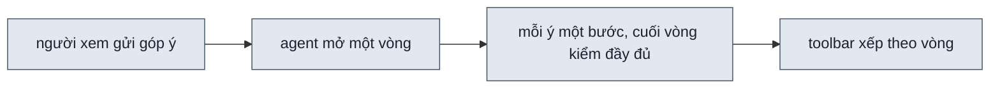
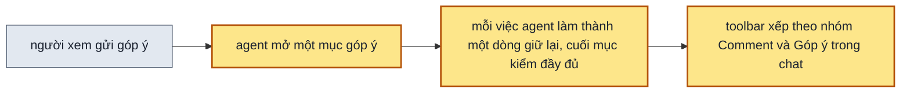

> **Nối tiếp:** [017](017-design-uiux-comment-tren-page.md) cho người xem comment ngay trên page. Plan này giải cái
> 017 để hở: danh sách tiến độ trên toolbar vẫn xếp góp ý theo "vòng", trộn comment với góp ý trong chat.
> **Lật:** cách góp ý thành bước theo vòng của [009](009-design-uiux-tien-do-dung.md) và D5 của
> [017](017-design-uiux-comment-tren-page.md). **Giữ:** bước chuẩn bị, sáu bước dựng, bước giao.

## 1. Problem

Người xem bấm nhãn tiến độ trên toolbar thì thấy "Góp ý vòng 2", "Góp ý vòng 3"… Họ không biết vòng là gì: đó là cách
skill gom các bước bên trong, lộ ra giao diện. Comment gửi từ page và ý gõ trong chat cùng nằm dưới chữ "Góp ý:".
Muốn biết comment #3 xong chưa và agent đã làm gì cho nó, người xem phải dò qua các vòng. Việc agent làm cho một góp ý
chỉ hiện tạm một dòng, xong là mất. Andy thử trên page 076 với năm comment và đề nghị bỏ vòng.

## 2. Goal

- Danh sách tiến độ trên toolbar không có chữ "vòng". Sau phần chuẩn bị và dựng là nhóm "Comment" (comment gửi từ
  page, mỗi mục có số) và nhóm "Góp ý trong chat" (ý gõ trong chat, không số); nhóm nào trống thì không hiện.
- Mỗi comment và mỗi ý trong chat là một mục có dấu xong hay đang làm của riêng nó; ngay dưới mục là các việc agent đã
  làm cho nó. Mục này xong không chờ mục khác.
- Nhãn tiến độ ghi đang sửa gì: "Đang sửa #3" với comment, "Đang sửa góp ý" với ý trong chat, kèm việc đang làm.
- Page có danh sách xếp theo vòng vẫn mở được: các bước góp ý cũ hiện thành mục trong đúng nhóm.

**Ngoài scope:** phần chuẩn bị, dựng, giao của danh sách. Ghim và chế độ comment trên page.

## 3. Mental model

**Bây giờ chạy thế nào** — Người xem gửi một comment. Agent mở một vòng góp ý cho page: một bước cho ý đó và một bước
kiểm đầy đủ. Trong lúc làm, agent ghi việc đang làm, nó hiện thành một dòng nhạt dưới bước. Làm xong bước thì dòng đó
mất. Toolbar xếp các bước theo vòng: "Góp ý vòng 2", "Góp ý vòng 3".



**Sau plan chạy thế nào** — Mỗi comment, mỗi ý trong chat là một mục góp ý. Agent mở mục, ghi lần lượt từng việc mình
làm: việc trước thành dấu xong và ở lại, việc đang làm có chấm. Cuối cùng agent kiểm đầy đủ rồi đóng mục. Toolbar xếp
các mục vào hai nhóm "Comment" và "Góp ý trong chat", việc đã làm thụt vào dưới từng mục.



**Hành vi đổi ra sao:**

| # | Tình huống | Bây giờ | Sau plan |
| --- | --- | --- | --- |
| `BH1` | comment #3 đang sửa | danh sách có "Góp ý vòng 3 · Góp ý: Comment #3: …" | nhóm Comment có mục "#3 …", việc đang làm thụt ngay dưới |
| `BH2` | một tin chat có hai ý | một vòng, hai bước, một lần kiểm chung | hai mục trong "Góp ý trong chat", mỗi mục kiểm riêng |
| `BH3` | agent làm xong một việc cho góp ý | dòng việc mất | dòng việc thành dấu xong, ở lại dưới mục |
| `BH4` | nhãn tiến độ lúc đang sửa | "Đang sửa 1/2" | "Đang sửa #3 · <việc>" hay "Đang sửa góp ý · <việc>" |
| `BH5` | mở page có danh sách xếp theo vòng | — | bước "Góp ý: Comment #n" vào nhóm Comment, bước góp ý khác vào nhóm chat |

**Không đụng:** chế độ comment, ghim, lệnh nghe comment; sáu bước dựng.

---

## 5. Decisions

**Ai quyết:** 🤖 = agent tự quyết, chưa hỏi ai — **chỗ người duyệt phải soi** · 👤 = user chốt lúc bàn (luật 22).

### D1 👤 — Bỏ vòng khỏi giao diện và khỏi dữ liệu; mỗi comment, mỗi ý trong chat là một mục góp ý

**Lý do:** vòng là cách gom bước bên trong; người xem chỉ cần biết từng góp ý xong chưa → DS1.

### D2 👤 — Comment và góp ý trong chat là hai nhóm riêng; ý trong chat không tính là comment

**Lý do:** comment có số, có ghim, có chỗ chọn trên page; ý trong chat không có những thứ đó → DS3.

### D3 🤖 — Mỗi mục có lần kiểm đầy đủ riêng, kể cả khi một tin chat có nhiều ý

**Lý do:** mục xong là xong thật, không chờ mục khác. Đổi lại mỗi ý tốn thêm 30–100 giây kiểm.
**Phương án đã loại:** một lần kiểm chung cho cả tin chat. Mục đầu phải đứng "đang làm" tới khi ý cuối xong.

### D4 🤖 — Việc agent làm ghi bằng `--doing`; `--doing` kế tiếp biến việc trước thành xong và giữ lại

**Lý do:** agent đã quen ghi việc con bằng `--doing`; chỉ đổi là việc cũ không mất → DS2.

### D5 🤖 — Danh sách xếp theo vòng được đọc chuyển đổi khi hiện; file cũ không bị viết lại

**Lý do:** thư mục design cũ (076, 077) vẫn mở bằng shell mới. Lệnh `progress` gặp file cũ thì chuyển một lần lúc ghi
→ DS4.

## 6. Design

### DS1 — Dạng `.progress.js`

`build` chỉ còn sáu bước dựng và bước agent dựng chèn thêm; field `round` không còn. Thêm mảng `feedback`:

| field | kiểu | ghi chú |
| --- | --- | --- |
| `source` | `comment` · `chat` | comment gửi từ page hay ý gõ trong chat |
| `id` | số | số comment; chỉ có khi `source` là `comment` |
| `task` | chuỗi | tóm tắt góp ý |
| `done` | bool | mục xong sau `--checked` |
| `actions` | mảng `{task, done}` | việc agent đã làm, theo thứ tự; việc cuối `{task: "Kiểm đầy đủ", final: true}` |

```js
"feedback": [
  { "source": "comment", "id": 3, "task": "tab lọc đậm hơn", "done": true,
    "actions": [{ "task": "Chữ tab đang chọn đậm 600", "done": true }, { "task": "Kiểm đầy đủ", "done": true, "final": true }] }
]
```

### DS2 — CLI Surface của `progress`

| Lệnh | Làm gì | `rev` |
| --- | --- | --- |
| `--comment <id> "<tóm tắt>"` | mở mục comment; bước giao mở lại | giữ |
| `--chat "<ý>"` | mở mục ý trong chat; bước giao mở lại | giữ |
| `--doing "<việc>"` | mục đang mở: việc trước (nếu có) thành xong, việc này thành đang làm | tăng khi có việc trước thành xong |
| `--checked` | việc đang làm và việc "Kiểm đầy đủ" thành xong, mục xong | tăng |
| `--doing`, `--done`, `--insert` khi chưa xong sáu bước dựng | như hiện nay, cho bước dựng | như hiện nay |

- Mỗi lúc chỉ một mục mở. `--comment`, `--chat` khi còn mục mở → exit 1, in mục đang mở.
- `--comment` với `id` đã có mục → exit 1.
- `--round` → exit 1, in "dùng --comment <id> hay --chat".
- `--delivered` khi còn mục mở → exit 1, như còn bước dựng chưa xong.
- In danh sách (`progress` không cờ): nhóm Comment, Góp ý trong chat, việc thụt dưới mục.

### DS3 — Danh sách và nhãn trên toolbar

| Nhóm | Dòng | Dưới dòng |
| --- | --- | --- |
| Chuẩn bị | bước chuẩn bị | — |
| Dựng | sáu bước dựng | việc con của bước dựng dở |
| Comment | `#<id> <task>`, dấu ✓ hay ● | các việc trong `actions`, ✓ hay ● |
| Góp ý trong chat | `<task>`, dấu ✓ hay ● | các việc trong `actions` |
| Giao | bước giao | — |

- Nhóm không có mục thì không hiện.
- Việc kiểm đầy đủ (`final`) không có dòng trong danh sách; lúc nó đang chạy thì nhãn ghi "… · Kiểm đầy đủ".
- Nhãn: mục comment đang mở → "Đang sửa #<id>"; mục chat → "Đang sửa góp ý"; kèm "· <việc đang làm>" như hiện nay.
- Thanh tiến độ ở đáy nhãn: phần đã xong là số việc xong trên số việc của mục đang mở.

**Đổi (2026-10-14):** bỏ dòng "Kiểm đầy đủ" khỏi danh sách — Andy: mục nào cũng có, chỉ lặp. Agent đóng việc cuối bằng
`--doing "Kiểm đầy đủ"` trước khi chạy `check.mjs` đầy đủ — lượt chạy thử 077 thấy SKILL.md cấm lệnh này trong khi
`check.mjs` đòi việc trước phải đóng.

### DS4 — Đọc danh sách xếp theo vòng

| Dữ liệu cũ | Thành |
| --- | --- |
| bước `round ≥ 2` tên `Góp ý: Comment #<n>: <tóm tắt>` | mục `comment`, `id` n |
| bước `round ≥ 2` tên `Góp ý: <ý>` khác | mục `chat` |
| bước `Kiểm đầy đủ` (`final`) của một vòng | việc cuối của mọi mục trong vòng đó, cùng dấu xong |
| bước `round ≥ 2` chèn bằng `--insert` | mục `chat` |

Shell và `readProgress` của `new-design.mjs` dùng cùng phép chuyển. Lệnh `progress` ghi lại file thì ghi dạng mới.

### DS5 — Luật và máy kiểm

| Chỗ | Đổi |
| --- | --- |
| SKILL.md "Vòng sau" | góp ý trong chat: mỗi ý `--chat`, `--doing` từng việc, kiểm đầy đủ, `--checked`; bỏ chữ vòng |
| SKILL.md "Comment trên page" | `--comment <id>`; comment tới khi còn mục mở thì chờ |
| `references/build-page.md` | agent con sửa theo góp ý dùng `--doing`, `--checked` |
| `check.mjs` kiểm đầy đủ | page còn mục chưa xong thì báo lỗi, trừ việc "Kiểm đầy đủ" của mục đang mở |
| SPEC | `F4.4` `F6.8` `F7.5` `F7.10` update; sub-scope mới cho hai nhóm trên toolbar |

### DS6 — Test Strategy

| File | Ca |
| --- | --- |
| `scripts/test-progress.mjs` | mở mục comment, `--doing` hai lần giữ việc đầu là xong, `--checked`; mở mục khi còn mục mở → exit 1; `--round` → exit 1; file xếp theo vòng đọc ra mục đúng nhóm |
| `scripts/test-shell.mjs` | danh sách có nhóm Comment và Góp ý trong chat, không chữ "vòng"; nhãn "Đang sửa #<id>"; file xếp theo vòng hiện đúng nhóm |

## 7. Phases

**Legend:** 🤖 = agent tự kiểm được (chạy lệnh, test, grep) · 👤 = cần người kiểm (số đo thật, UI, hạ tầng).

- [x] 👤 plan này được duyệt — 2026-10-14, Andy: "lưu plan 018 và triển khai"

### Phase 0 — ghi doc nguồn

**Goal:** SPEC nói mục góp ý thay cho vòng; mục 018 trong PLANS.md ở `approved`.
**Cover:** —

**Actions:**

- [x] 🤖 SPEC: `F4.4` `F6.8` `F7.5` `F7.10` update, sub-scope mới cho hai nhóm trên toolbar, §3.1 và §3.4 theo DS1, DS3 (D1 · D2) — 2026-10-14: thêm `F6.16`; `F5.7` ở §3.6 nói mục góp ý; §3.5 Góp ý dùng `--chat`; §4 ba dòng lý do
- [x] 🤖 PLANS.md: mục `018` `approved`, bảng mã — 2026-10-14, 6 mã

**Gate:**

- [x] 🤖 `grep -n "vòng" skills/design-uiux/SPEC.md` không còn dòng nào nói danh sách xếp theo vòng — 2026-10-14: còn "vòng lan" của chấm, "ba vòng" sửa lỗi lúc kiểm, đoạn tả cách đọc file kiểu cũ, lý do bỏ vòng
- [x] 🤖 `python3 ~/.claude/skills/write-plan/verify.py .plans/018-design-uiux-danh-sach-gop-y.md` — 0 ERROR — 2026-10-14

### Phase 1 — dữ liệu và lệnh

**Goal:** `progress --comment`, `--chat`, `--doing`, `--checked` ghi mục góp ý; file xếp theo vòng đọc ra mục.
**Cover:** DS1 · DS2 · DS4

**Actions:**

- [x] 🤖 `new-design.mjs`: `feedback`, cờ mới, chuyển đổi dữ liệu cũ, bỏ `--round` (D3 · D4 · D5) — 2026-10-14; thêm: `--doing` đúng tên việc cuối chỉ đóng việc đang làm, không thêm dòng (gặp khi xử lý comment #6); bước `Comment #n:` chèn bằng `--insert` cũng thành mục comment
- [x] 🤖 `test-progress.mjs`: ca theo DS6 — 2026-10-14, 13 ca mới thay các ca vòng

**Gate:**

- [x] 🤖 `node skills/design-uiux/scripts/test-progress.mjs` exit 0 — DS1 · DS2 · DS4 · BH2 · BH3 — 2026-10-14: 49 ✓
- [x] 🤖 `progress` không cờ trên bản chép của 076 in nhóm Comment với #1…#5, không chữ "vòng" — DS4 · BH5 — 2026-10-14, trên chính 076: #1…#5 từ dữ liệu vòng, #6 ghi bằng `--comment`, `--doing` ×3, `--checked`

### Phase 2 — shell

**Goal:** toolbar hiện hai nhóm, việc thụt dưới mục, nhãn "Đang sửa #id".
**Cover:** DS3

**Actions:**

- [x] 🤖 `shell.js`: vẽ nhóm, nhãn, đọc dữ liệu cũ (D5) — 2026-10-14, `normalizeProgress` trong shell cùng phép chuyển với `new-design.mjs`
- [x] 🤖 `test-shell.mjs`: ca theo DS6; `shell-principles.md` mục nhãn tiến độ — 2026-10-14, 4 ca thay ca vòng

**Gate:**

- [x] 🤖 `test-shell.mjs` exit 0, có ca nhóm Comment, Góp ý trong chat, nhãn "Đang sửa #" — DS3 · BH1 · BH4 — 2026-10-14: 93 ✓; nhãn "Đang sửa #3 · Giữ bề rộng tab", "Đang sửa góp ý · Kiểm đầy đủ"; việc thụt 20px; file kiểu cũ ra #1, #2, "nút to hơn"

### Phase 3 — luật và máy kiểm

**Goal:** agent chạy skill dùng mục góp ý; `check.mjs` chặn page còn mục dở.
**Cover:** DS5 · DS6

**Actions:**

- [x] 🤖 SKILL.md, `references/build-page.md`, `check.mjs` theo DS5, mỗi mục SKILL.md có dòng `spec:` — 2026-10-14: SKILL.md mental model, danh sách lệnh, bảng khối điều khiển, "Vòng sau", "Comment trên page"; `build-page.md` mục mới "Sửa theo góp ý"; `check.mjs` đọc qua `normalizeProgress`
- [x] 🤖 `test-check.mjs` thêm ca page còn mục góp ý dở — 2026-10-14, C26 (còn việc dở → báo), C27 (chỉ còn kiểm đầy đủ → không báo)

**Gate:**

- [x] 🤖 `node scripts/spec-check.mjs skills/design-uiux` 0 lỗi; `grep -n "\-\-round" skills/design-uiux/SKILL.md skills/design-uiux/references/build-page.md` không ra dòng nào — DS5 — 2026-10-14: `✓ 76 sub-scope`; grep exit 1
- [x] 🤖 `test-check.mjs` exit 0, ca mục dở báo lỗi — DS5 · DS6 — 2026-10-14: 27 ca, 0 ca trượt

### Phase 4 — nghiệm thu

**Goal:** mỗi bullet §2 có bằng chứng từ page thật.
**Cover:** —

**Actions:**

- [x] 🤖 chép shell mới vào 076, mở danh sách tiến độ, chụp ảnh — 2026-10-14, cả 077
- [x] 🤖 `claude -p --resume` lượt 077 với một góp ý chat hai ý, `--auto` — 2026-10-14: chạy session mới (`chat-feedback.sh`) thay `--resume`, vì session cũ giữ SKILL.md bản trước trong ngữ cảnh; 175 giây, 17 tool_use, 0 `--round`
- [ ] 👤 Andy gửi một comment trên 076, xem danh sách trong lúc agent sửa

**Gate:**

- [x] 🤖 §2 bullet 1: danh sách của 076 có nhóm Comment, không chữ "vòng"; 077 sau lượt resume có nhóm Góp ý trong chat — BH1 · BH5 — 2026-10-14: 077 `progress` in nhóm Comment (#1) và Góp ý trong chat (2 mục)
- [x] 🤖 §2 bullet 2: 077 có hai mục chat, mỗi mục có việc thụt dưới và "Kiểm đầy đủ" riêng — BH2 · BH3 — 2026-10-14: "Đổi tiêu đề trang thành Lịch hẹn" (✓ Đổi chữ tiêu đề trang), "Nút Thêm lịch hẹn nổi hơn" (✓ Phóng to nút Thêm lịch hẹn), mỗi mục một lần `check.mjs` đầy đủ
- [ ] 👤 §2 bullet 3: lúc agent sửa comment của Andy, nhãn ghi "Đang sửa #<id> · <việc>" — BH4
- [x] 🤖 §2 bullet 4: 076 (dữ liệu xếp theo vòng) hiện #1…#5 trong nhóm Comment — BH5 — 2026-10-14: nhóm Chuẩn bị · Dựng · Comment · Giao; #1…#5 mỗi mục một việc "Kiểm đầy đủ"; #6 ba việc rồi "Kiểm đầy đủ"; không chữ "vòng"
- [ ] 🤖 `python3 ~/.claude/skills/write-plan/verify.py .plans/018-design-uiux-danh-sach-gop-y.md` — 0 ERROR
