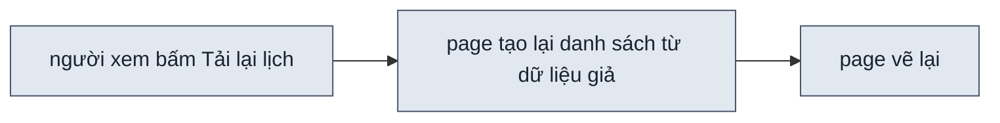
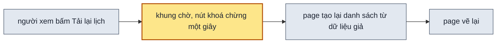

## 1. Problem

Trên page prototype, có những nút mà app thật phải hỏi server mới có kết quả: "Tải lại lịch", "Thử lại", "Lưu",
"Gửi". Bấm các nút này thì page hoặc đứng y nguyên, hoặc nhảy thẳng sang kết quả, không có lúc chờ. Người xem không
thấy app sẽ phản ứng thế nào khi bấm. Andy gặp ca này trên page lịch hẹn của lượt 076: ở cảnh 0 lịch hẹn, bấm "Tải lại
lịch" thì không có gì xảy ra. Máy kiểm cho page qua, vì máy kiểm chỉ báo nút không gắn việc gì, còn nút này có gắn.

## 2. Goal

- Khi người xem bấm một nút làm mới dữ liệu (Tải lại, Thử lại) hay nút gửi form (Lưu, Gửi), page hiện đang tải chừng
  một giây và khoá nút trong lúc chờ, rồi hiện kết quả thành công trên dữ liệu giả.
- Khi người xem bấm Tải lại ở cảnh rỗng, page hiện đang tải rồi quay lại cảnh rỗng.
- Khi một cú bấm không làm page đổi gì, máy kiểm báo tên nút đó.
- Khi nút Tải lại, Thử lại, Làm mới, Lưu hay Gửi bấm xong mà page không qua lúc chờ, máy kiểm báo tên nút đó.
- Khi người xem bấm lại tab hay nút đang được chọn sẵn, máy kiểm không báo.
- Khi máy kiểm bấm một nút có lúc chờ, máy kiểm đo bố cục lúc đã tải xong, không đo khung chờ.

**Ngoài scope:** cú bấm ra lỗi. Người xem xem cảnh lỗi bằng cách chọn trạng thái lỗi ở panel, như hiện nay. Thao tác
trên một dòng (đánh dấu đã đến, xoá) vẫn đổi ngay, không có lúc chờ. Hai cách ra cảnh rỗng (số lịch hẹn bằng 0 và
trạng thái "rỗng") vẫn để nguyên.

## 3. Mental model

**Bây giờ chạy thế nào** — Người xem mở page ở cảnh 0 lịch hẹn và bấm "Tải lại lịch". Page tạo lại danh sách từ dữ
liệu giả. Số lịch hẹn vẫn là 0, nên danh sách tạo lại vẫn rỗng, và page vẽ ra đúng cảnh cũ. Người xem không thấy gì
đổi. Khi máy kiểm bấm thử nút này, máy kiểm chỉ xem nút có gắn việc không, rồi đo bố cục ngay. Máy kiểm không so page
trước và sau cú bấm.



**Sau plan chạy thế nào** — Người xem bấm "Tải lại lịch". Khung chờ đúng hình các dòng thay chỗ cảnh rỗng. Chừng một
giây sau, page tạo lại danh sách và vẽ kết quả, ở đây vẫn là cảnh rỗng.
Người xem thấy app đã hỏi server và server trả về. Khi máy kiểm bấm thử, nó ghi lại page trước cú bấm. Nó theo dõi page
tới khi hết lúc chờ. Nếu page không đổi lần nào, thì máy kiểm báo tên nút. Máy kiểm đo bố cục sau khi đã tải xong.



**Hành vi đổi ra sao:**

| # | Tình huống | Bây giờ | Sau plan |
| --- | --- | --- | --- |
| `BH1` | bấm "Tải lại lịch" ở cảnh 0 lịch hẹn | page y nguyên | khung chờ thay cảnh rỗng chừng một giây, rồi lại cảnh rỗng |
| `BH2` | bấm "Thử lại" ở cảnh lỗi | tuỳ page: nhảy ngay sang có dữ liệu, hoặc không gì | khung chờ, rồi ra danh sách có dữ liệu |
| `BH3` | bấm "Lưu" trong form thêm lịch hẹn | form đóng ngay, dòng mới hiện | nút "Đang lưu…" khoá chừng một giây, rồi form đóng, dòng mới hiện |
| `BH4` | máy kiểm bấm một nút mà page không đổi gì | không báo | báo `bấm "Tải lại lịch" mà page không đổi gì` |
| `BH5` | máy kiểm bấm lại tab đang được chọn | không báo | không báo |
| `BH6` | máy kiểm bấm một nút có lúc chờ | đo bố cục ngay sau cú bấm | đo bố cục khi đã tải xong |
| `BH7` | máy kiểm bấm "Thử lại" mà page nhảy ngay sang có dữ liệu | không báo | báo `nút "Thử lại" gọi server mà không có lúc chờ` |

**Không đụng:** shell (toolbar, panel, comment); thao tác trên một dòng như đánh dấu đã đến hay xoá; các luật UX, UI
khác của máy kiểm.

---

## 4. Probe

### P1 — Máy kiểm có báo nhầm nút đang chạy đúng là "không đổi gì" không?

**Biết để làm gì:** nếu báo nhầm ít, máy kiểm chỉ cần bỏ qua thứ đang được chọn sẵn. Nếu báo nhầm nhiều (nút bật
tắt, nút mở thứ nằm ngoài page, nút chép), thì cần thêm luật bỏ qua, hoặc lỗi này chỉ là cảnh báo cho agent soát tay.
**Cách chạy lại:** `PW_DIR=$TMPDIR/design-uiux-pw node .probes/019-design-uiux-bam-nhu-that/P1-bam-khong-doi/probe3.mjs`.
Thư mục `input/` chứa page chép từ `.tests/design-uiux/058`, `064`, `071`, `076`, `077`. Ở mỗi page, script bấm từng thứ bấm được
theo cách lượt bấm của `check.mjs` chọn, so page trước và sau, rồi in các nút bị báo.
**Kết quả:** 0 báo nhầm trên 391 cú bấm ở 9 page; 24 cú bấm bỏ qua vì thứ được bấm đang được chọn sẵn
(`probe3.log`, 2026-10-14, Chrome 155, Playwright 1.64). Hai lần đo trước báo nhầm 16 nút vì cách chụp ảnh của probe.
`probe2.log` đếm phần tử theo loại, nên khi tab cũ bỏ chọn và tab mới được chọn, số đếm vẫn như cũ. Nó cũng không
ghi vị trí cuộn, nên ô chuyến xe cuộn tới nhóm đơn bị coi là không đổi. `probe3.log` ghi phần tử theo thứ tự và ghi vị
trí cuộn. Lượt bấm chỉ bấm mỗi nút ở tổ hợp đầu tiên nó hiện ra. "Tải lại lịch" của page 076 hiện đầu tiên ở
`state=empty`, và ở đó nó nhảy sang có dữ liệu, nên lượt so không bắt được ca gốc. Cả 14 nút Tải lại, Thử lại trên 9
page đều xong trong 67–87 ms, không nút nào có lúc chờ.

## 5. Decisions

**Ai quyết:** 🤖 = agent tự quyết, chưa hỏi ai — **chỗ người duyệt phải soi** · 👤 = user chốt lúc bàn (luật 22).

### D1 👤 — Nút gọi server luôn trả thành công; cảnh lỗi xem bằng giá trị lỗi của `state` ở panel

**Lý do:** giữ luật hiện có của `build-page.md`: kết quả chỉ hiện sau cú bấm thì làm thành giá trị `state`. Nếu thêm
nút vặn "lần gọi tới lỗi", thì vặn nó không đổi gì trên page, và máy kiểm báo nút vặn khai thừa.
**Phương án đã loại:** nút vặn "Lần gọi tới: thành công / lỗi" ở panel.

### D2 👤 — "Tải lại" ở cảnh rỗng: qua lúc chờ rồi vẫn rỗng

**Lý do:** một ngày chưa ai đặt thì tải lại vẫn chưa có lịch. Lúc chờ đủ cho người xem thấy app đã hỏi server.
**Phương án đã loại:** tải lại ra 2–3 lịch mới, giả như vừa có người đặt.

### D3 🤖 — Nút chờ server gồm nút làm mới (Tải lại, Thử lại) và nút gửi form (Lưu, Gửi, Đặt); thao tác trên một dòng đổi ngay

**Lý do:** app thật thường đổi dòng ngay rồi mới gửi server ở thao tác nhỏ. Nếu mỗi lần đánh dấu đã đến đều chờ một
giây, thì page chậm hơn app thật → DS1.

### D4 🤖 — Lúc chờ, vùng nhận kết quả gắn `aria-busy="true"`; nút khoá và đổi chữ

**Lý do:** `aria-busy` là thuộc tính thật cho trình đọc màn hình. Máy kiểm đọc nó để biết lúc nào hết chờ → DS1 · DS2.
**Phương án đã loại:** hàm chung trong shell để page gọi. Hàm đó chỉ bọc `setTimeout` và một cờ, page tự viết được 5
dòng. Thêm vào shell thì shell có thêm một chỗ phải giữ tương thích.

### D5 🤖 — Máy kiểm báo cú bấm không làm page đổi gì, trừ thứ đang được chọn sẵn

**Lý do:** nút có gắn việc mà việc không đổi gì là lỗi lọt qua lượt kiểm "nút không làm gì" hiện có. Dựa vào `P1` → DS2.

### D6 🤖 — Máy kiểm đợi hết `aria-busy` (tối đa 3 giây) rồi mới đo bố cục sau cú bấm

**Lý do:** nếu đo lúc khung chờ, thì máy kiểm đo hình của trạng thái đang tải, không đo kết quả của cú bấm → DS2.

### D7 🤖 — Nút có nhãn gọi server (Tải lại, Thử lại, Làm mới, Lưu, Gửi) bấm xong mà không có `aria-busy` thì máy kiểm báo

**Lý do:** dựa vào `P1`: lượt so trước và sau không bắt được ca gốc, còn cả 14 nút loại này đều không có lúc chờ → DS2.
**Phương án đã loại:** bấm mỗi nút ở mọi tổ hợp nó hiện ra. Lượt bấm sẽ dài gấp số tổ hợp.

## 6. Design

### DS1 — Luật nút chờ server trong `references/build-page.md`

Mục "Trạng thái và dữ liệu giả" thêm luật:

| Loại nút | Ví dụ | Khi bấm |
| --- | --- | --- |
| làm mới dữ liệu | Tải lại, Thử lại, Làm mới | vùng danh sách hiện khung chờ, gắn `aria-busy="true"`; sau 600–900 ms tạo lại dữ liệu từ variables, `state` về `data` nếu đang `error` hay `loading` |
| gửi form | Lưu, Gửi, Đặt, Xác nhận | nút `disabled`, chữ "Đang lưu…" / "Đang gửi…", form gắn `aria-busy="true"`; sau 600–900 ms đổi dữ liệu giả, đóng form |
| thao tác trên một dòng | Đã đến, Xoá, đổi trạng thái | đổi ngay, không chờ |

Đoạn code mẫu kèm luật:

```js
busy: false,
async reload() {
  this.busy = true;
  await new Promise((done) => setTimeout(done, 700));
  this.reset();
  this.busy = false;
},
```

```html
<section :aria-busy="busy" data-block="3">…</section>
<button :disabled="busy" @click="reload()" x-text="busy ? 'Đang tải…' : 'Tải lại lịch'"></button>
```

- Khi `state` ở panel là `empty`, nút làm mới vẫn trả cảnh rỗng (D2).
- Khi `state` ở panel là `error`, nút "Thử lại" trả cảnh có dữ liệu (D1).

### DS2 — Lượt so trước và sau cú bấm trong `check.mjs`

Áp cho lượt bấm của kiểm đầy đủ (`clickOnce`) và cho `--quick --click`.

| Bước | Máy kiểm làm |
| --- | --- |
| trước bấm | cuộn thứ được bấm vào khung nhìn; nếu nó có `aria-selected="true"`, `aria-pressed="true"` hay `aria-current`, thì bỏ qua lượt so; ghi `before` = chữ (`innerText`) của `#design`, danh sách phần tử đang hiện theo thứ tự (thẻ, class, `aria-selected` `aria-pressed` `aria-expanded` `aria-current` `aria-checked`), giá trị ô nhập, `location.search`, vị trí cuộn |
| lúc bấm | gắn `MutationObserver` lên `#design`; mỗi lần DOM đổi, so ảnh chụp mới với `before`, khác thì `changed = true` |
| sau bấm | `settle`, rồi chờ không còn `[aria-busy="true"]` nào đang hiện mà trước bấm không có, tối đa 3000 ms; quá thời gian thì báo `bấm "<nhãn>" mà page chờ quá 3 giây` |
| kết luận | trang sang file khác thì bỏ qua; nếu `changed` vẫn `false`, thì báo `bấm "<nhãn>" mà page không đổi gì` |
| nút gọi server | nếu nhãn khớp `/^(tải lại\|thử lại\|làm mới\|lưu\|gửi\|reload\|retry\|refresh\|save\|send\|submit)/i` mà từ lúc bấm tới lúc kết luận không có `[aria-busy="true"]` mới nào hiện, thì báo `nút "<nhãn>" gọi server mà không có lúc chờ` |
| đo | `reportLayout`, `afterClick`, `pageProbe` chạy sau bước chờ |

Lỗi "không đổi gì" gắn với `F5.12`, lỗi "không có lúc chờ" gắn với `F5.13`; không gắn luật UX nào.

### DS3 — Test Strategy

| File | Ca |
| --- | --- |
| `scripts/test-check.mjs` C30 | page có nút `@click` gán lại đúng dữ liệu cũ → `--quick --click` báo "mà page không đổi gì" |
| `scripts/test-check.mjs` C31 | page có nút theo đoạn mẫu DS1 (700 ms, kết quả giống cũ) → không báo; lỗi bố cục chỉ có ở khung chờ không bị báo |
| `scripts/test-check.mjs` C32 | tab đang `aria-selected="true"` bấm lại → không báo |
| `scripts/test-check.mjs` C33 | nút "Thử lại" đổi `state` ngay, không `aria-busy` → báo "gọi server mà không có lúc chờ" |

```bash
node skills/design-uiux/scripts/test-check.mjs
```

## 7. Phases

**Legend:** 🤖 = agent tự kiểm được (chạy lệnh, test, grep) · 👤 = cần người kiểm (số đo thật, UI, hạ tầng).

- [x] 👤 plan này được duyệt — 2026-10-14, Andy: "triển khai 019"

### Phase 0 — ghi doc nguồn

**Goal:** SPEC có hai yêu cầu mới; mục 019 trong PLANS.md ở `approved`.
**Cover:** —

**Actions:**

- [x] 🤖 SPEC Feature requirement: thêm `F3.10` (nút chờ server), `F5.12` (cú bấm không đổi gì), `F5.13` (nút gọi server không có lúc chờ) — 2026-10-14 (D1 · D3 · D7)
- [x] 🤖 SPEC §3.3 thêm `F3.10` vào Scope, tả lúc chờ; §3.6 tả lượt so trước và sau cú bấm; §4 thêm lý do D2 · D4 (D2 · D4) — 2026-10-14: §4 thêm 5 dòng, 3 ở "Page và shell", 2 ở "Kiểm"
- [x] 🤖 PLANS.md: mục `019` `approved` — 2026-10-14, 3 mã

**Gate:**

- [x] 🤖 `grep -n "F3.10\|F5.12\|F5.13" skills/design-uiux/SPEC.md` ra cả ở Feature requirement và Technical design — 2026-10-14: dòng 66, 82, 83, 273, 327, 489, 495
- [x] 🤖 `python3 ~/.claude/skills/write-plan/verify.py .plans/019-design-uiux-bam-nhu-that.md` — 0 ERROR — 2026-10-14

### Phase 1 — máy kiểm bắt cú bấm không đổi gì

**Goal:** `check.mjs` báo nút "Tải lại lịch" của page 076: không đổi gì ở `count=0`, không có lúc chờ ở `state=empty`.
**Cover:** DS2 · DS3

**Actions:**

- [x] 🤖 `check.mjs`: lượt so trước và sau trong `clickOnce` và `--quick --click`, chờ `aria-busy`, nút gọi server (D5 · D6 · D7) — 2026-10-14: `watchClick`, `clickSettled`, `clickOutcome`, `serverLabel`
- [x] 🤖 `principles-check.mjs` `checks`: không thêm dòng — lỗi gắn `F5.12`, không gắn luật UX — 2026-10-14, file không đổi
- [x] 🤖 `test-check.mjs`: C30 · C31 · C32 · C33 theo DS3 — 2026-10-14; C31 trượt khi tạm cho máy kiểm không đợi (cuộn ngang 864px lúc khung chờ)

**Gate:**

- [x] 🤖 `node skills/design-uiux/scripts/test-check.mjs` exit 0, C30 và C33 báo, C31 và C32 không báo — DS2 · DS3 · BH4 · BH5 · BH6 · BH7 — 2026-10-14: 33 ca, 0 trượt, 213 giây. Log 21 ca cũ có "không có lúc chờ" ở nút Thử lại, Tải lại, Gửi báo cáo của page mẫu: đúng luật mới; "không đổi gì" chỉ ở C30
- [x] 🤖 bản chép page 076: `--quick --preset "Không có lịch hẹn nào" --click "Tải lại lịch"` báo "không đổi gì"; kiểm đầy đủ báo "Tải lại lịch" và "Thử lại" không có lúc chờ — DS2 · BH4 · BH7 — 2026-10-14, `.tests/design-uiux/078-check-076-bam-nhu-that/`: kiểm nhanh 2 lỗi, 3,6 giây; kiểm đầy đủ 3 lỗi, 158 tổ hợp, 26,7 giây, cả "không đổi gì" ở `count=0`

### Phase 2 — luật dựng page

**Goal:** agent dựng page viết nút làm mới và nút gửi form có lúc chờ.
**Cover:** DS1

**Actions:**

- [x] 🤖 `references/build-page.md` mục "Trạng thái và dữ liệu giả": bảng loại nút, đoạn code mẫu, dòng `spec:` thêm `F3.10` (D3 · D4) — 2026-10-14: mục con "Nút chờ server"; bảng sáu bước: bước 2 và 4 thêm nút chờ và lệnh `--click`
- [x] 🤖 `references/build-page.md` mục "Kiểm": hai lỗi mới và cách sửa, dòng `spec:` thêm `F5.12` `F5.13` (D5 · D7) — 2026-10-14
- [x] 🤖 sửa tay bản chép của page 076 theo đoạn mẫu DS1 — 2026-10-14: `reload()` 700 ms cho Tải lại lịch và Thử lại; `retrySave()` 700 ms cho Thử lại dưới dòng lưu thất bại; bản trước sửa ở `01-bang-lich-hen.before.html`

**Gate:**

- [x] 🤖 `node scripts/spec-check.mjs skills/design-uiux` 0 lỗi — 2026-10-14: `✓ 79 sub-scope`
- [x] 🤖 bản chép 076 sửa theo đoạn mẫu: kiểm đầy đủ không báo "không đổi gì" hay "không có lúc chờ" — DS1 · BH1 — 2026-10-14: kiểm đầy đủ exit 0, 158 tổ hợp, 0 lỗi; `--preset "Không có lịch hẹn nào" --click "Tải lại lịch"` 0 lỗi; mở ở `count=0`: 150 ms khung chờ, 1050 ms lại cảnh rỗng

### Phase 3 — nghiệm thu

**Goal:** mỗi bullet §2 có bằng chứng từ page dựng bằng skill thật.
**Cover:** —

**Actions:**

- [x] 🤖 chạy bài `samples/04-quick-screen` ở `--auto`, kết quả ở `.tests/design-uiux/079-sample-04-quick-screen-nghiem-thu-019/` — 2026-10-14: 957 giây, 55 lượt, giao một page; `run.log`: `--click "Làm mới danh sách"` ở `state=empty` 1 lỗi rồi 0 lỗi
- [ ] 👤 Andy mở page của lượt đó, bấm Tải lại ở cảnh rỗng và Thử lại ở cảnh lỗi

**Gate** — một dòng ứng một bullet §2:

- [x] 🤖 §2 bullet 1: nút làm mới, gửi form của lượt 079 qua `--quick --click` có khung chờ rồi kết quả — BH2 · BH3 — 2026-10-14, `bam-thu-nut-cho.log`: Tải lại lịch, Thử lại, Làm mới danh sách, Thử lưu lại đều có `aria-busy` ở 150 ms, nút "Đang tải…" khoá; Thử lại ra 160 dòng chữ ở 1100 ms. Page không có nút Lưu, Gửi
- [ ] 👤 §2 bullet 2: ở cảnh rỗng, bấm Tải lại thấy khung chờ rồi lại cảnh rỗng — chờ Andy mở page 079 ở `?count=0`, bấm "Làm mới danh sách" · BH1
  Agent đã đo bằng script: `count=0` và `state=empty` đều có khung chờ ở 150 ms, lại cảnh rỗng ở 1100 ms (`bam-thu-nut-cho.log`).
- [x] 🤖 §2 bullet 3: kiểm đầy đủ lượt 079 không có lỗi "không đổi gì"; bản 076 gốc có — BH4 — 2026-10-14: 079 kiểm đầy đủ 182 tổ hợp 0 lỗi; 078 (076 gốc) báo "Tải lại lịch" ở `count=0`
- [x] 🤖 §2 bullet 4: kiểm đầy đủ lượt 079 không có lỗi "không có lúc chờ"; bản 076 gốc có — BH7 — 2026-10-14: 079 0 lỗi; 078 báo "Tải lại lịch" và "Thử lại" ở 4 chỗ
- [x] 🤖 §2 bullet 5: kiểm đầy đủ lượt 079 không báo tab đang chọn — BH5 — 2026-10-14: tab "Tất cả 30" đang chọn, kiểm đầy đủ 0 lỗi
- [x] 🤖 §2 bullet 6: `shots/` của lượt 079 không có ảnh khung chờ sau cú bấm — BH6 — 2026-10-14: `--quick --click "Tải lại lịch"` ra `01-bang-lich-hen--quick-click.png` là bảng 30 ca, không khung chờ
- [x] 🤖 `python3 ~/.claude/skills/write-plan/verify.py .plans/019-design-uiux-bam-nhu-that.md` — 0 ERROR — 2026-10-14
