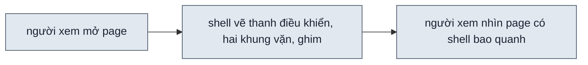
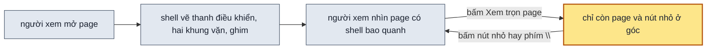

## 1. Problem

Page thiết kế luôn có thanh điều khiển ở trên cùng. Trên màn rộng, hai khung vặn dữ liệu và vặn cấu hình đứng cố định
ở hai lề. Comment chưa sửa có ghim đánh số nằm trên page. Người xem muốn nhìn bản thiết kế như người dùng thật sẽ thấy,
hay chụp màn hình gửi người khác, thì không tắt được các khối này: chụp xong phải tự cắt ảnh, và ghim vẫn đè lên page.
Andy đề nghị thêm một nút ẩn chúng đi.

## 2. Goal

- Thanh điều khiển có nút "Xem trọn page". Khi người xem bấm nút, thanh điều khiển, hai khung vặn và ghim comment
  biến mất. Page giữ nguyên khổ màn, sáng tối, các giá trị đang vặn và bề rộng.
- Khi shell đang ẩn, góc trên phải màn hình có một nút nhỏ, mờ. Khi người xem bấm nút đó hay nhấn phím `\`, mọi thứ hiện
  lại như trước lúc ẩn. Nhấn `\` khi shell đang hiện thì shell ẩn. Khi con trỏ đang ở ô nhập, `\` là chữ.
- Khi page tự tải lại hay người xem sang màn kế trong luồng, shell vẫn ẩn. Link chép gửi người khác mở ra vẫn có thanh
  điều khiển.
- Khi page chưa dựng xong, nút nhỏ ở góc có chấm nhấp nháy, nên người xem biết agent còn đang làm mà không phải mở lại.
- Ở màn 375px, nút "Xem trọn page" vẫn có, và thanh điều khiển vẫn nằm trong màn hình.

**Ngoài scope:** link mở sẵn ở chế độ ẩn shell. Ẩn shell trong bản publish (việc `PQ-07`).

## 3. Mental model

**Bây giờ chạy thế nào** — Người xem mở page. Shell vẽ thanh điều khiển ở trên cùng, rồi vẽ hai khung vặn ở hai lề nếu
màn đủ rộng. Ghim comment chưa sửa nằm trên page. Ở khổ tablet, mobile, page nằm trong một khung máy giữa màn hình.
Người xem không có cách nào bỏ các khối đó đi, nên mọi ảnh chụp đều dính chúng.



**Sau plan chạy thế nào** — Thanh điều khiển có thêm nút "Xem trọn page". Bấm nút đó thì shell cất hết các khối của
nó, chỉ để lại một nút nhỏ mờ ở góc trên phải. Tab trình duyệt nhớ lựa chọn này, nên page tự tải lại vẫn ẩn. Bấm nút
nhỏ hay nhấn `\` thì shell vẽ lại như cũ.



**Hành vi đổi ra sao**

| #     | Tình huống | Bây giờ | Sau plan |
| ----- | ---------- | ------- | -------- |
| `BH1` | bấm "Xem trọn page" ở khổ desktop, màn rộng | không có nút | thanh, hai khung vặn, ghim biến mất; page dịch lên chỗ thanh để lại, giữ nguyên bề rộng; góc trên phải còn nút nhỏ |
| `BH2` | shell đang ẩn, người xem bấm nút nhỏ hay nhấn `\` | — | mọi thứ hiện lại như trước lúc ẩn |
| `BH3` | shell đang ẩn ở khổ mobile | — | khung máy giữ nguyên giữa màn hình, chỉ thanh và khung vặn biến mất |
| `BH4` | chế độ comment đang bật, người xem ẩn shell | — | chế độ comment tắt; cú bấm vào page chạy nút của page |
| `BH5` | page tự tải lại hay sang màn kế khi shell đang ẩn | — | shell vẫn ẩn |
| `BH6` | page đang dựng dở, shell đang ẩn | — | nút nhỏ có chấm nhấp nháy |
| `BH7` | con trỏ ở ô nhập của page, người xem gõ `\` | — | ô nhập nhận chữ `\`, shell không đổi |
| `BH8` | mở link chép từ page đang ẩn shell trong tab khác | — | page có thanh điều khiển |

**Không đụng:** bản thiết kế trong page, cách page tự tải lại, lệnh nghe comment, máy kiểm page.

---

## 5. Decisions

**Ai quyết:** 🤖 = agent tự quyết, chưa hỏi ai — **chỗ người duyệt phải soi** · 👤 = user chốt lúc bàn (luật 22).

### D0 👤 — view-controller có nút ẩn shell, đứng cuối dãy, chỉ có icon

**Lý do:** Andy đề nghị trong chat 2026-10-14. Ẩn shell là một cách nhìn page, cùng nhóm với khổ màn, sáng tối.
**Phương án đã loại:** nút có chữ — toolbar ở 375px không còn chỗ.

### D1 🤖 — Shell hiện lại bằng nút nhỏ mờ ở góc trên phải hay phím `\`; Esc không hiện lại shell

**Lý do:** chỉ có phím thì người xem chạm, hay người không biết phím, không có đường quay lại. `\` theo Cmd+\ của Figma.
**Phương án đã loại:** Esc hiện lại shell. Người xem ẩn shell để xem modal của page, rồi bấm Esc đóng modal, thì shell
bật lại ngoài ý muốn. Hiện khi rê lên mép trên: màn cảm ứng không có rê.

### D2 🤖 — Khổ tablet, mobile giữ khung máy; chỉ shell quanh khung ẩn

**Lý do:** ẩn shell bỏ phần điều khiển, không đổi cách nhìn page. Người xem đang xem khổ mobile thì vẫn muốn thấy khổ
mobile.

### D3 🤖 — Ẩn shell thì tắt chế độ comment

**Lý do:** chế độ comment chặn cú bấm vào page và cần ghim, ô viết. Người xem ẩn shell để bấm page như người dùng thật.

### D4 🤖 — Trạng thái ẩn nằm trong `sessionStorage` của thư mục design, không lên URL

**Lý do:** tự tải lại và sang màn kế trong luồng giữ trạng thái. Link chép gửi đi luôn mở có shell, nên người nhận thấy
nút vặn.
**Phương án đã loại:** ghi lên URL — người nhận link mở ra page không có thanh điều khiển và không biết vì sao.

### D5 🤖 — Nút hiện lại mang chấm tiến độ khi page chưa xong

**Lý do:** nhãn tiến độ nằm trong toolbar, ẩn theo. Không có chấm thì người xem không biết page còn đang được dựng.

## 6. Design

### DS1 — Giao diện và trạng thái

| Phần | Khi shell hiện | Khi shell ẩn |
| --- | --- | --- |
| `.ds-bar` (toolbar, hai panel, danh sách tiến độ) | như hiện tại | `display: none` |
| `.ds-comment-pins`, `.ds-comment-hint`, `.ds-help-tip` ở trang cha và trong iframe | như hiện tại | `display: none` |
| `.ds-frame-wrap` và iframe khổ tablet, mobile | như hiện tại | giữ nguyên (D2) |
| `[data-ds-shell-hide]` cuối `.ds-bar-view`, icon 32×32, `title` "Xem trọn page (phím \)" | hiện ở mọi bề rộng | ẩn theo thanh |
| `[data-ds-shell-show]` `position: fixed`, `top: 12px`, `right: 12px`, 32×32, `opacity: 0.45`, rê hay Tab tới thì 1 | `display: none` | hiện; `title` "Hiện toolbar và panel (phím \)" |
| `[data-ds-shell-show] .ds-shell-show-dot` | — | hiện khi `data-state` khác `done`, vòng lan như chấm nhãn tiến độ (D5) |

Trạng thái:

| Thứ | Giá trị |
| --- | --- |
| store | `Alpine.store("shell").hidden` (boolean) |
| thuộc tính trên `<html>` | `data-shell-hidden`, đặt ngay khi `shell.js` chạy, trước khi Alpine vẽ, để page tải lại không loé thanh |
| `sessionStorage` | key `ds-shell:<thư mục design>`, giá trị `"1"` hay `"0"` (D4) |
| iframe | trang cha gửi `{ type: "design:shell", hidden }` lúc đổi và lúc iframe tải xong; iframe đặt `data-shell-hidden` |
| phím | `event.key === "\\"`, không xét Ctrl, Cmd, Alt; bỏ qua khi `event.repeat`, ô viết comment đang mở, hay con trỏ ở `typingSelector`. Trong iframe gửi `{ type: "design:shell-toggle" }` lên trang cha |
| comment | `hidden` thành `true` thì `Alpine.store("comment").on = false` (D3) |
| chấm tiến độ | `renderStatus()` ghi `data-state` = `progressStatus().state` lên `[data-ds-shell-show]` |
| bày lại thanh | `hidden` thành `false` thì gọi `alignBar()` ở khung hình kế |

### DS2 — Luật trong SPEC, SKILL.md, shell-principles

| File | Chỗ | Nội dung |
| --- | --- | --- |
| `SPEC.md` | `F2` | `F2.9` Khi người xem bấm nút ẩn shell trên view-controller, shell ẩn toolbar, panel và ghim comment, giữ page cùng mọi giá trị đang xem. |
| `SPEC.md` | §3.4 bảng khối | dòng view-controller thêm "ẩn shell"; thêm dòng "nút hiện shell" |
| `SKILL.md` | "Các khối điều khiển" | dòng view-controller thêm nút ẩn shell, phím `\`, `[data-ds-shell-hide]`; dòng `spec:` thêm `F2.9` (gắn `F2` đã phủ, ghi rõ để tra) |
| `references/shell-principles.md` | mục mới "Ẩn shell: xem trọn page" | các luật ở DS1, kèm lý do của D1–D5 |

### DS3 — Test Strategy

Thêm khối vào `scripts/test-shell.mjs`, chạy trên `.design-uiux/` mẫu sẵn có của script:

| Ca | Thư mục mẫu, bề rộng | Đạt khi |
| --- | --- | --- |
| H1 | `shell-test`, 1600 (panel mở sẵn) | bấm `[data-ds-shell-hide]`: `.ds-bar` không có hình, ghim không có hình, `[data-ds-shell-show]` nằm trong màn hình, khung `#design` không đổi `left` và `width`, URL không đổi |
| H2 | như H1 | `\` hiện lại; `\` lần nữa ẩn; tải lại vẫn ẩn; bấm `[data-ds-shell-show]` hiện lại, thanh cùng `left`, `right` như trước khi ẩn |
| H3 | `shell-test`, 1280 | bật comment rồi ẩn shell: `data-commenting` không còn |
| H4 | `shell-test`, 1280, `viewport=mobile` | ẩn: iframe vẫn có hình, rộng 375; nhấn `\` trong iframe thì shell hiện lại |
| H5 | `shell-test`, 375 | `[data-ds-shell-hide]` có hình, `right` ≤ 375 |
| H6 | `tien-do` đang dựng | ẩn: `[data-ds-shell-show]` có `data-state="building"`, chấm có hình |
| H7 | `shell-test`, ô nhập của page | gõ `\` vào ô: ô nhận chữ, `.ds-bar` vẫn có hình |
| H8 | tab mới, cùng URL với tab đang ẩn | `.ds-bar` có hình |
| H9 | `luong`, màn 1 | ẩn rồi bấm "Tiếp tục" trong page: màn 2 mở ra, shell vẫn ẩn |

```bash
node skills/design-uiux/scripts/test-shell.mjs --pw <thư mục có node_modules/playwright>
```

**Baseline:** 97 ✓ · 0 ✗ trước khi sửa shell — 2026-10-14, Chrome của Playwright trong `$TMPDIR/design-uiux-pw`.

## 7. Phases

**Legend:** 🤖 = agent tự kiểm được (chạy lệnh, test, grep) · 👤 = cần người kiểm (số đo thật, UI, hạ tầng).

- [x] 👤 plan này được duyệt — 2026-10-14, Andy: "lên plan để triển khai luôn"

### Phase 0 — ghi doc nguồn

**Goal:** SPEC có `F2.9`; mục `PQ-09` trong PLANS.md thành mục `021` ở `approved`.
**Cover:** —

**Actions:**

- [x] 🤖 SPEC.md: `F2.9` và hai dòng §3.4 theo DS2 (D0) — 2026-10-14
- [x] 🤖 PLANS.md: chuyển `PQ-09` sang Plan thành `### 021`, thêm dòng **Plan:**, status `approved` — 2026-10-14

**Gate:**

- [x] 🤖 `node scripts/spec-check.mjs skills/design-uiux` không báo lỗi PLANS.md; `F2.9` có mục SKILL.md nhờ gắn `F2` — ✓ 80 sub-scope, 2026-10-14
- [x] 🤖 `python3 ~/.claude/skills/write-plan/verify.py .plans/021-design-uiux-an-shell.md` — 0 ERROR, 0 WARN, 2026-10-14

### Phase 1 — nút ẩn và hiện shell

**Goal:** người xem ẩn shell bằng nút, hiện lại bằng nút góc hay phím `\`, trên mọi khổ.
**Cover:** DS1 · DS2 · DS3

**Actions:**

- [x] 🤖 chạy `test-shell.mjs` trên shell hiện tại, ghi baseline — 97 ✓ · 0 ✗, 76 giây, 2026-10-14
- [x] 🤖 `shell/shell.js`: store `shell`, nút ẩn, nút hiện, phím `\`, tin nhắn iframe, tắt comment, chấm tiến độ (D1 · D2 · D3 · D4 · D5) — `node --check` sạch, 2026-10-14
- [x] 🤖 `shell/shell.css`: luật ẩn và hai nút theo DS1 — 2026-10-14
- [x] 🤖 `scripts/test-shell.mjs`: ca H1–H9 — 9 dòng `expect` mới, 2026-10-14
- [x] 🤖 SKILL.md, `references/shell-principles.md` theo DS2 — 2026-10-14

**Gate:**

- [x] 🤖 `test-shell.mjs` exit 0, H1–H9 ✓, các ca cũ không ✗ mới so với baseline — 106 ✓ · 0 ✗, 2026-10-14 — DS1 · DS3 · BH1 · BH2 · BH3 · BH4 · BH5 · BH6 · BH7 · BH8
- [x] 🤖 `node scripts/spec-check.mjs skills/design-uiux` 0 lỗi — DS2 · ✓ 80 sub-scope, 2026-10-14

### Phase 2 — nghiệm thu

**Goal:** mỗi bullet §2 có bằng chứng trên một thư mục design thật.
**Cover:** —

Plan chỉ đổi shell, không đổi việc agent làm, nên nghiệm thu không chạy lại skill. Thư mục design thật lấy từ lượt
`078` (một page lịch hẹn, có danh sách bước dựng và comment), chép sang `.tests/design-uiux/080-nghiem-thu-021-an-shell/`,
rồi `new-design.mjs shell` thay shell mới. Sang màn kế trong luồng chỉ có ở thư mục luồng mẫu của `test-shell.mjs`.

**Actions:**

- [x] 🤖 chép `.design-uiux/` của lượt `078` sang `080-nghiem-thu-021-an-shell/`, chạy `new-design.mjs shell` — `_shell/shell.js` trùng bản skill, 2026-10-14
- [x] 🤖 chụp ảnh shell hiện và ẩn ở 1760 (1600 chưa mở sẵn panel vì trang rộng 1200px), 1280 khổ mobile, 375; lưu vào `080/shots/` bằng `nghiem-thu.mjs` — 2026-10-14
- [ ] 👤 Andy mở page `01-bang-lich-hen.html` trong thư mục `080`, bấm ẩn, hiện, nhấn `\`

**Gate** — một dòng ứng một bullet §2:

- [x] 🤖 §2 bullet 1: ảnh 1600 ẩn không còn thanh, panel, ghim; `#design` cùng `left`, `width` — BH1 · 1760: panel trước true, sau ẩn; khối trang 280/1200 → 280/1200; ghim đo ở `test-shell.mjs` (ghim trước true, sau ẩn) — `.tests/design-uiux/080-nghiem-thu-021-an-shell/nghiem-thu.log`
- [ ] 👤 §2 bullet 2: nút góc và `\` hiện lại, `\` ẩn, gõ `\` trong ô tìm kiếm ra chữ — BH2 · BH7
  Máy đã đo đạt (`nghiem-thu.log` bullet 2, ca H2 · H7). Chờ Andy bấm thử bằng tay trên page `080`.
- [x] 🤖 §2 bullet 3: tải lại page `080` khi đang ẩn, vẫn ẩn; mở URL ở tab mới thì có thanh; ca H9 ✓ — BH5 · BH8 · `.tests/design-uiux/080-nghiem-thu-021-an-shell/nghiem-thu.log`, 2026-10-14
- [x] 🤖 §2 bullet 4: đánh dấu một bước dựng chưa xong bằng lệnh `progress`, nút góc có chấm — BH6 · bước giao để chưa xong trên bản chép, `state: checking`, chấm có hình, `.tests/design-uiux/080-nghiem-thu-021-an-shell/nghiem-thu.log`
- [x] 🤖 §2 bullet 5: ảnh 375 có nút ẩn shell trong màn hình — BH3 · nút trong 375px; khổ mobile ẩn shell giữ khung 377px, `.tests/design-uiux/080-nghiem-thu-021-an-shell/nghiem-thu.log`
- [x] 🤖 `python3 ~/.claude/skills/write-plan/verify.py .plans/021-design-uiux-an-shell.md` — 0 ERROR, 0 WARN, 2026-10-14
