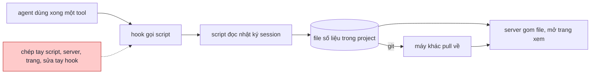
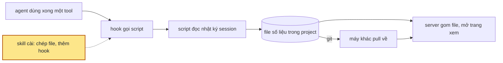

## 1. Problem

Project spec-kit-todo-metrics có một tool ghi lại từng session Claude Code: mỗi prompt, mỗi lần gọi model và tool, thời
gian, token, subagent. Có một trang để xem các số đó. Tool chỉ sống trong project đó. Muốn đo project khác thì phải tự
chép ba file, tự sửa file cấu hình hook, và tự nhớ đổi đường dẫn. Lúc đổi chỗ file trong project đó, hook trỏ sai
đường dẫn suốt ba phút mà không ai biết, vì hook lỗi thì im lặng. Andy muốn cài tracking vào project bất kỳ bằng một
lệnh. Andy cũng muốn mở project ở máy nào cũng thấy đủ session của mọi máy.

## 2. Goal

- Khi người dùng gọi skill trong một project, agent cài tracking bằng một lệnh. Từ prompt kế tiếp, mỗi session chạy
  trong project có một file số liệu trong thư mục `.metrics/sessions/` của project.
- Chạy lại lệnh cài ở project đã cài thì script và hook được thay bản mới. Hook không bị nhân đôi. Số liệu đã ghi và cấu
  hình riêng của project còn nguyên.
- Người dùng gõ `python3 .metrics/serve_metrics.py` thì trình duyệt mở trang xem metric. Trang hiện mọi session trong
  `.metrics/sessions/`, kể cả session do máy khác ghi rồi đẩy qua git. Session đang chạy trên máy này tự cập nhật sau
  vài giây.
- File số liệu không chứa secret dạng token, `KEY=value`, header xác thực. File không chứa nội dung file `.env`, không
  chứa dữ liệu ảnh, không chứa bản chép SKILL.md.
- Project muốn giấu cả nội dung prompt và output thì đặt một dòng cấu hình. Khi đó file chỉ còn số liệu.

**Ngoài scope:** Windows. Lệnh gỡ cài. Tự commit file số liệu. Gộp nhiều project vào một trang. Hook audit và hook
`/implement` của spec-lite.

## 3. Mental model

**Bây giờ chạy thế nào** — Trong spec-kit-todo-metrics, mỗi lần agent dùng xong một tool, Claude Code gọi hook. Hook
chạy script đọc lại nhật ký session mà Claude Code tự ghi trên máy, rồi viết một file số liệu cho session đó vào thư
mục của project. Người dùng commit thư mục này, nên máy khác pull về là có file. Người dùng gõ lệnh mở server, server
gom mọi file, gắn trạng thái đang chạy hay đã dừng, rồi trả cho trang xem. Ba file script, server, trang xem nằm sẵn
trong project. Hook được viết tay vào file cấu hình của project. Project khác không có gì cả.



**Sau plan chạy thế nào** — Cùng đường đó. Chỉ khác chỗ ba file và hook đến từ đâu. Agent gọi skill, skill chạy lệnh
cài: chép script, server, trang vào `.metrics/` của project, rồi thêm hook vào file cấu hình mà không đụng hook khác.
Lệnh cài nhận ra hook cũ của chính nó và thay tại chỗ, nên cài lại để nâng cấp không sinh hook trùng. Script đọc thêm
một file cấu hình nhỏ trong `.metrics/`, nơi project khai cách gom skill hay bật chế độ chỉ giữ số liệu.



**Hành vi đổi ra sao**

| #     | Tình huống                                        | Bây giờ                                              | Sau plan                                                     |
| ----- | ------------------------------------------------- | ---------------------------------------------------- | ------------------------------------------------------------ |
| `BH1` | Project chưa có tracking                          | Phải chép tay ba file và sửa tay file cấu hình hook   | Agent chạy một lệnh. Prompt kế tiếp đã có file số liệu       |
| `BH2` | Cài lại ở project đã cài                          | Không có lệnh cài                                    | File mới thay file cũ, hook không nhân đôi, số liệu còn nguyên |
| `BH3` | Project đã có bản tool cũ, hook trỏ `scripts/`    | Phải sửa tay từng hook                               | Lệnh cài thay hook cũ bằng hook mới                         |
| `BH4` | Máy khác clone project, chưa chạy session nào     | Mở trang thấy session do máy kia commit               | Như bây giờ                                                  |
| `BH5` | Agent in ra token hay đọc file `.env`             | Đã che, nhưng chỉ ở spec-kit-todo-metrics             | Mọi project cài skill đều che                               |
| `BH6` | Project public muốn giấu cả prompt và output      | Không có cách                                        | Đặt chế độ chỉ giữ số liệu, file không còn chữ nào          |
| `BH7` | Project dùng spec-lite cần gom skill theo chặng   | Danh sách chặng ghi cứng trong script                 | Danh sách nằm trong file cấu hình của project               |

**Không đụng:** cách đọc nhật ký session và dựng số liệu, giao diện trang xem, hook audit và hook `/implement` của
spec-lite.

---

## 4. Probe

### P1 — Bộ mẫu che secret có che nhầm code không?

**Biết để làm gì:** che nhầm nhiều thì phần input, output của tool bị nát, ghi đầy đủ mất nghĩa; khi đó phải bỏ hẳn
input, output thay vì che từng chuỗi
**Cách chạy lại:** `python3 .probes/022-session-metrics/P1-redact-patterns/probe.py` (lần 1) ·
`python3 .probes/022-session-metrics/P1-redact-patterns/probe2.py` (lần 2), trên 10 file session chép trong `input/`
**Kết quả:** lần 1, mẫu `KEY=value` không phân biệt hoa thường bắt 91 chỗ, phần lớn che nhầm code
(`PROXY_SECRET: string;`, `password = page.getByTestId(`). Lần 2, chỉ bắt tên viết hoa và bỏ giá trị là kiểu dữ liệu
hay biến: 9 chỗ, đều là secret thật. Mẫu `sk-`, `ghp_`, `AKIA`, JWT: 0 chỗ. `probe.log`, `probe2.log` — 2026-10-23,
python 3.9.6. Bản lần 2 còn lọt tên trơn `PASSWORD` và header `X-…-Secret:`; bản đang chạy ở spec-kit-todo-metrics đã
vá hai lỗ đó: 14 ca thử, 0 sai, 27 chỗ che trên 11 session

### P2 — Đọc lại transcript sau mỗi tool tốn bao lâu?

**Biết để làm gì:** nếu đọc lại cả project mất vài giây, thì hook chạy sau mỗi tool sẽ dồn tiến trình nền và máy nóng;
khi đó hook phải chỉ đọc session gọi nó
**Cách chạy lại:** `PROJ=-Users-andy-Code-namitfruits-skills python3 .probes/022-session-metrics/P2-parse-time/probe.py`
**Kết quả:** project namitfruits/skills, 60 session, 495 MB: cả project 2,14 s; session 141,6 MB: 0,71 s.
`probe.log` — 2026-10-23, python 3.9.6

### P3 — File số liệu nặng ở phần nào?

**Biết để làm gì:** chỉ ra phần cắt được mà không mất thông tin, trước khi chốt ghi đầy đủ
**Cách chạy lại:** `python3 .probes/022-session-metrics/P3-metric-weight/probe.py`
**Kết quả:** 10 file, 5,36 MB: output tool 30 %, input tool 22 %, khoảng trắng do thụt lề 12 %, bản ghi chen giữa lượt
10 % (trong đó bản chép SKILL.md 0,34 MB), mảnh base64 ảnh 23 KB. `probe.log` — 2026-10-23, python 3.9.6

## 5. Decisions

**Ai quyết:** 🤖 = agent tự quyết, chưa hỏi ai — **chỗ người duyệt phải soi** · 👤 = user chốt lúc bàn (luật 22).

### D0 👤 — Script, server, trang xem được chép vào `.metrics/` của project; hook gọi bản trong project

**Lý do:** clone project ở máy nào cũng tracking ngay, máy đó không cần cài skill.
**Phương án đã loại:** hook gọi script trong thư mục skill — máy chưa cài skill thì hook im lặng, không ghi gì. → DS1

### D1 👤 — Số liệu đi giữa các máy qua git: commit `.metrics/sessions/*.json`

**Lý do:** không cần dịch vụ ngoài. Mỗi máy chỉ ghi file của session chạy trên máy đó, nên hai máy không sửa cùng một
file.
**Phương án đã loại:** thư mục chung ngoài repo (iCloud, Dropbox) — mỗi máy phải cấu hình đường dẫn.

### D2 👤 — Ghi đầy đủ prompt, câu trả lời, input và output của tool, nhưng che secret trước khi ghi

**Lý do:** dựa vào `P1` — mẫu siết chặt chỉ bắt secret thật, nên giữ được nội dung mà không lộ token. → DS5
**Phương án đã loại:** bỏ input, output của tool — mất phần giúp đọc lại session đã làm gì.

### D3 👤 — Trang xem đọc thẳng `.metrics/sessions/*` qua server local; không sinh file gộp

**Lý do:** chỉ một nguồn dữ liệu. Trang mở bằng `file://` không `fetch` được file khác, nên cần server. → DS6
**Phương án đã loại:** file gộp `metrics.js` nạp bằng thẻ script — thêm một bản sao 5 MB phải sinh lại sau mỗi tool.

### D4 🤖 — Hook chỉ đọc lại transcript của session gọi nó, lấy đường dẫn từ payload hook

**Lý do:** dựa vào `P2` — đọc cả project tốn 2 s sau mỗi tool, đọc một session tốn dưới 1 s. Đường dẫn từ payload còn
đúng cả khi Claude Code mở ở thư mục con. → DS2

### D5 🤖 — Ảnh thành một dòng mô tả, bản chép SKILL.md thành tên skill, file ghi một giá trị mỗi dòng không thụt lề

**Lý do:** dựa vào `P3` — ba phần này không mang thông tin về việc session làm. Một giá trị mỗi dòng thì git vẫn so
được từng dòng. → DS5

### D6 🤖 — Danh sách skill mở chặng và chế độ chỉ giữ số liệu nằm trong `.metrics/config.json`, không nằm trong cờ lệnh

**Lý do:** hook và lần chạy tay cùng đọc một chỗ. Đặt cờ ở hook thì lần chạy tay quên cờ sẽ ghi lại đầy đủ. Hai ca
thật: spec-kit-todo-metrics cần danh sách chặng của spec-lite; repo public cần chế độ chỉ giữ số liệu. → DS4

### D7 🤖 — Lệnh cài nhận ra hook của mình bằng tên file `sync_metrics.py` trong lệnh, rồi thay tại chỗ

**Lý do:** spec-kit-todo-metrics có hook trỏ `scripts/` hoặc `.metrics/`. Khớp theo tên file thì nâng cấp cả hai mà
không sinh hook trùng. → DS3

### D8 🤖 — Chỉ hỗ trợ macOS và Linux có `python3`

**Lý do:** server hỏi `ps` để biết session còn sống. Hook viết bằng cú pháp `sh`.

## 6. Design

### DS1 — Cấu trúc file

Trong repo skill:

```text
skills/session-metrics/
  SPEC.md
  SKILL.md
  PLANS.md
  metrics/                 ← chép nguyên vào <project>/.metrics/
    sync_metrics.py
    serve_metrics.py
    index.html
  scripts/
    install.py
```

Trong project sau khi cài:

```text
<project>/
  .claude/settings.json    ← thêm 5 hook, giữ hook khác
  .metrics/
    sync_metrics.py        ← lệnh cài ghi đè
    serve_metrics.py       ← lệnh cài ghi đè
    index.html             ← lệnh cài ghi đè
    config.json            ← lệnh cài chỉ tạo khi chưa có
    sessions/<sessionId>.json   ← commit vào git; lệnh cài không đụng
```

### DS2 — CLI Surface

| Lệnh | Làm gì | Exit |
| --- | --- | --- |
| `python3 <skill>/scripts/install.py [thư mục project]` | Cài vào thư mục được đưa, mặc định thư mục đang đứng. In từng file chép, từng hook thêm hay thay. | 0 xong · 1 thư mục không có hoặc `settings.json` hỏng JSON |
| `python3 .metrics/sync_metrics.py` | Đọc lại mọi transcript của project trên máy này | 0 |
| `python3 .metrics/sync_metrics.py --hook` | Đọc payload hook ở stdin, chỉ đọc lại session có `transcript_path`. Payload là transcript subagent thì đổi về transcript session cha. Payload hỏng thì đọc lại cả project. | 0 |
| `python3 .metrics/serve_metrics.py [--port N] [--no-open]` | Mở server ở `127.0.0.1`, mặc định cổng 8765, bỏ qua cổng đã có tiến trình nghe ở IPv4 hay IPv6, thử tối đa 20 cổng. In địa chỉ, mở trình duyệt, chạy sync tay một lượt ở nền. | 0 khi Ctrl+C · 1 hết cổng |

`install.py` không ghi đè `settings.json` hỏng JSON: in lỗi, exit 1.

### DS3 — Hook trong `.claude/settings.json`

| Event | Lệnh | `async` | `timeout` |
| --- | --- | --- | --- |
| `UserPromptSubmit`, `PostToolUse` (matcher `*`), `Notification`, `Stop` | `python3 "$CLAUDE_PROJECT_DIR/.metrics/sync_metrics.py" --hook 2>/dev/null \|\| true` | `true` | 30 |
| `SessionEnd` | `p=$(cat); printf '%s' "$p" \| nohup python3 "$CLAUDE_PROJECT_DIR/.metrics/sync_metrics.py" --hook >/dev/null 2>&1 &` | — | 10 |

Luật ghép:

- Với mỗi event, hook nào có lệnh chứa `sync_metrics.py` thì bị thay bằng lệnh ở bảng (D7). Nếu event có nhiều hook
  như vậy, thì giữ hook đầu, bỏ các hook sau.
- Nếu event chưa có hook nào chứa `sync_metrics.py`, thì lệnh cài thêm một nhóm mới ở cuối mảng của event đó.
- Hook khác giữ nguyên thứ tự và nội dung. File ghi lại với `indent=2`.

### DS4 — `.metrics/config.json`

```json
{ "content": "full", "stageSkills": [] }
```

| Key | Giá trị | Mặc định | Tác dụng |
| --- | --- | --- | --- |
| `content` | `"full"` · `"numbers"` | `"full"` | `numbers`: mọi chữ thành `null` — prompt, câu trả lời, `input`, `result`, `label`, `title`, `args` của skill run, `attachments`. Giữ tên tool, tên skill, token, thời gian. |
| `stageSkills` | mảng tên skill | `[]` | Skill trong mảng mở chặng mới, đóng skill điều phối đang mở (thay `STAGE_SKILLS` ghi cứng). |

File thiếu, hỏng JSON hay thiếu key thì script dùng mặc định cho key đó.

### DS5 — Bảng lọc nội dung

Lấy nguyên từ `spec-kit-todo-metrics/.metrics/sync_metrics.py`:

| Gặp gì | Ghi gì |
| --- | --- |
| `sk-…`, `gh[pousr]_…`, `AKIA…`, JWT, khối private key | `«redacted»` |
| `KEY=value`, `KEY: value` với tên viết hoa chứa `TOKEN` `SECRET` `PASSWORD` `PASSWD` `API_KEY` `APIKEY` `PRIVATE_KEY`; header `x-…-secret|token|key:`, `authorization:` | tên giữ nguyên, giá trị thành `«redacted»`; bỏ qua giá trị `string` `number` `boolean` `process.env…` `${…}` `$VAR` `os.environ` `***` `<…` |
| `Read` đọc tên file khớp `.env*` `*.pem` `*.key` `id_rsa*` `id_ed25519*` | `[bỏ output: file có thể chứa secret]` |
| khối `image` | `[ảnh <media_type>, <KB> KB]` |
| prompt bắt đầu `Base directory for this skill: <dir>` | `[nội dung skill <tên thư mục>]` |
| chuỗi dài | che trước, cắt sau: 1.500 ký tự, prompt 4.000, tiêu đề 300 |

File session ghi `json.dumps(…, indent=0, separators=(",", ":"))`.

### DS6 — API server

| Request | Trả |
| --- | --- |
| `GET /`, `GET /index.html` | `.metrics/index.html` |
| `GET /api/metrics` | `{project, machine, sessionDir, generatedAt, sessions[]}`; mỗi session thêm `state` (`running` · `waiting` · `idle` · `stopped`) và `pid`. Header `ETag` băm tên, giờ sửa, cỡ mỗi file cộng trạng thái sống. |
| `GET /api/metrics` kèm `If-None-Match` trùng | `304`, không body |
| `GET /favicon.ico` | `204` |
| đường khác | `404` |

Trang hỏi `/api/metrics` mỗi 3 giây khi ô "Tự cập nhật" bật và tab đang hiện. `fetch` lỗi lần đầu thì trang hiện lệnh
chạy server.

## 7. Phases

**Legend:** 🤖 = agent tự kiểm được (chạy lệnh, test, grep) · 👤 = cần người kiểm (số đo thật, UI, hạ tầng).

- [x] 👤 plan này được duyệt — 2026-10-23, Andy ("triển đi")

### Phase 0 — ghi doc nguồn

**Goal:** `skills/session-metrics/SPEC.md` có yêu cầu `F1`–`F4` và technical design theo plan đã duyệt; `PLANS.md` trỏ
về plan này.
**Cover:** —

**Actions:**

- [x] 🤖 `skills/session-metrics/SPEC.md`: mục tiêu, Feature requirement `F1` Cài vào project · `F2` Ghi session · `F3` Nội dung file session · `F4` Xem metric, mỗi sub-scope một câu EARS; Technical design theo §6 — SPEC.md 25 sub-scope
- [x] 🤖 `skills/session-metrics/PLANS.md`: mục `022` với bảng mã, mọi dòng `new` — bảng 25 mã sub-scope (spec-check đòi sub-scope, không nhận mã scope)

**Gate:**

- [x] 🤖 `node scripts/spec-check.mjs skills/session-metrics --list` liệt kê đủ sub-scope `F1`–`F4` — 25 sub-scope F1.1–F4.7
- [x] 🤖 `python3 ~/.claude/skills/write-plan/verify.py .plans/022-session-metrics.md` — 0 ERROR, 1 WARN (ô duyệt)

### Phase 1 — script, server, trang xem trong skill

**Goal:** chép tay `skills/session-metrics/metrics/` vào `.metrics/` của một project, chạy sync tay và server thì thấy
session của project đó.
**Cover:** DS4 · DS5 · DS6

**Actions:**

- [x] 🤖 `metrics/sync_metrics.py`, `metrics/serve_metrics.py`, `metrics/index.html`: chép từ `spec-kit-todo-metrics/.metrics/`, gắn `# spec:` đầu file (D0) — `# spec: F2 F3`, `# spec: F4`, `<!-- spec: F4 -->`
- [x] 🤖 `sync_metrics.py`: đọc `.metrics/config.json`; `stageSkills` thay `STAGE_SKILLS`; `content: "numbers"` xoá chữ trước khi ghi (D6) — `load_config`, `strip_text`, 2026-10-23
- [x] 🤖 `sync_metrics.py`: chuỗi trong docstring, comment không còn nhắc spec-lite hay project cụ thể — grep `spec-lite|spec-kit|/spec-test` ra 0 dòng

**Gate:**

- [x] 🤖 `diff` giữa skill và spec-kit-todo-metrics chỉ khác ở phần config và docstring — DS5 · DS6 — diff chỉ ở `load_config`, `STAGE_SKILLS`, `strip_text`, docstring, 2026-10-23
- [x] 🤖 Trên 11 session của spec-kit-todo-metrics, config `stageSkills` chép từ `STAGE_SKILLS` cũ cho ra `skillRuns` giống hệt bản cũ — DS4 · BH7 — 11/11 giống hệt cả file; `stageSkills: []` thì 2 session khác — `.tests/session-metrics/001-kiem-phase-1/check.log`
- [x] 🤖 Config `content: "numbers"`: grep file session không còn chữ prompt nào đã biết; `usage` giống bản `full` — DS4 · BH6 — 0/75 prompt còn; usage, toolCalls, số turn giống 11/11 — cùng log, 2026-10-23
- [x] 🤖 `curl` `/api/metrics` → 200 rồi 304 khi gửi lại ETag; `/favicon.ico` → 204 — DS6 — 200 rồi 304; favicon 204; / 200, 2026-10-23

### Phase 2 — lệnh cài và SKILL.md

**Goal:** agent gọi skill ở một project bất kỳ, chạy một lệnh, project có tracking.
**Cover:** DS1 · DS2 · DS3

**Actions:**

- [x] 🤖 `scripts/install.py`: chép `metrics/*` vào `.metrics/`, tạo `config.json` và `sessions/` nếu chưa có, ghép hook theo DS3 (D7) — `.tests/session-metrics/002-kiem-lenh-cai/check.log`
- [x] 🤖 `SKILL.md`: khi nào dùng, lệnh cài, lệnh xem, nhắc commit `.metrics/sessions/`, cách bật `numbers` và `stageSkills`, giới hạn của mẫu che secret; mọi mục có dòng `spec:` (D8) — 5 mục, mục nào cũng có dòng `spec:`
- [x] 🤖 `README.md` của repo: thêm dòng `session-metrics` — thêm dòng sau `design-uiux`, 2026-10-23
- [x] 🤖 `.claude/skills` symlink có sẵn, `session-metrics` gọi được — `.claude/skills/session-metrics/SKILL.md` có, 2026-10-23

**Gate:**

- [x] 🤖 `install.py` trên thư mục trống có `.claude/settings.json` mang một hook lạ: hook lạ còn nguyên, thêm đủ 5 hook — DS3 · BH1 — hook lạ `PreToolUse`, `PostToolUse matcher Bash` và key `model` còn; mỗi event 1 hook sync — 002/check.log mục 1
- [x] 🤖 Chạy `install.py` lần hai: `settings.json` không đổi byte nào; `config.json` đã sửa tay còn nguyên — DS2 · BH2 — shasum trùng; config `numbers` sửa tay còn nguyên — mục 2
- [x] 🤖 `settings.json` hỏng JSON: exit 1, file không bị ghi — DS2 — exit 1, file còn `{"hooks": {` — mục 3
- [x] 🤖 `node scripts/spec-check.mjs skills/session-metrics` — 0 lỗi — DS1 — `✓ 25 sub-scope · 1 approved`

### Phase 3 — nghiệm thu

**Goal:** mỗi bullet §2 có một lượt chạy thật, kết quả ghi lại cạnh ô tick.
**Cover:** —

**Actions:**

- [x] 🤖 `.tests/session-metrics/003-nghiem-thu/`: repo git trống `origin.git`, clone `a/`, gọi skill ở `a/` chế độ tự chạy, rồi chạy `claude -p` ở `a/` một prompt có in token giả, đọc `.env` giả, đọc một ảnh, sinh một subagent; commit, push `.metrics/sessions/` — làm ở `003-nghiem-thu/` (001, 002 đã dùng cho Gate phase 1, 2); `claude -p` sonnet-5-5 tự gọi skill và cài, 2026-10-23
- [x] 🤖 Clone `b/` ở đường dẫn khác (máy chưa chạy session nào), mở server ở `b/` — `~/.claude/projects` không có thư mục transcript nào của `b/`, 2026-10-23
- [x] 🤖 Chạy lệnh cài ở `spec-kit-todo-metrics`, đặt `stageSkills` cũ vào config — config 12 `stageSkills` tạo trước khi cài — `check-upgrade-spec-kit.log`, 2026-10-23

**Gate:**

- [x] 🤖 §2 bullet 1: sau `claude -p` ở `a/`, `.metrics/sessions/<id>.json` có, chứa subagent lồng đúng dòng Agent — BH1 — 2 file: phiên cài 3 tool, phiên thử 5 tool, `Sub 1 (general-purpose)` nằm dưới dòng `Agent` — `.tests/session-metrics/003-nghiem-thu/check-goal.log`
- [x] 🤖 §2 bullet 2: cài lại ở `a/` và ở spec-kit-todo-metrics, mỗi event còn đúng một hook `sync_metrics.py`, hook trỏ `scripts/` cũ bị thay, số file session không đổi — BH2 · BH3 — `a/`: settings.json trùng shasum, 2 → 2 file session; spec-kit: mỗi event 1 hook, 11 hook audit, implement còn, 9/9 session đã dừng không bị ghi lại — `check-reinstall-numbers.log`, `check-upgrade-spec-kit.log`, 2026-10-23
- [x] 👤 §2 bullet 3: server ở `b/` hiện session của `a/` với trạng thái đã dừng; server ở spec-kit-todo-metrics hiện session đang chạy cập nhật trong vòng vài giây — BH4 — Andy giao agent tự kiểm, 2026-10-23
  Agent đã kiểm bằng Chrome headless: `b/` hiện 2 session "Đã dừng", ảnh `.tests/session-metrics/003-nghiem-thu/view-b.png`; spec-kit 3 lần ETag đổi trong 30 s, trang vẽ lại mỗi lần — `check-live-spec-kit.log`. Andy giao agent tự kiểm thay cho mở trang.
- [x] 🤖 §2 bullet 4: file session ở `a/` không có token giả, nội dung `.env` giả, base64, chữ `Base directory for this skill` — BH5 — chuỗi cấm còn: không (token `ghp_`, `sk-ant-`, giá trị `.env`, base64, `Base directory`); `.env` → `[bỏ output…]`, ảnh → `[ảnh image/png, 7 KB]` — `check-goal.log`, 2026-10-23
- [x] 🤖 §2 bullet 5: đặt `content: "numbers"` ở `a/`, sync tay, file không còn prompt đã gõ — BH6 — grep 4 câu prompt, câu trả lời: 0 file; token 181803, 291093 và tên tool giữ nguyên — `check-reinstall-numbers.log`, 2026-10-23
- [x] 🤖 `python3 ~/.claude/skills/write-plan/verify.py .plans/022-session-metrics.md` — 0 ERROR, 0 WARN — 2026-10-23
