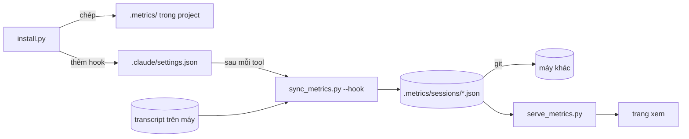

# session-metrics

<!-- spec: — -->

Claude Code tự ghi mọi session vào transcript `~/.claude/projects/<project>/<sessionId>.jsonl`. Transcript chỉ nằm
trên máy chạy session và rất nặng (ảnh base64, bản chép SKILL.md). Skill này cài vào project một hook dựng từ
transcript một file số liệu gọn cho mỗi session, khoảng 7 % cỡ transcript. File được commit cùng project.



## Cài vào project

<!-- spec: F1 -->

1. Agent xác định gốc project: thư mục chứa `.claude/` hay `.git/` mà người dùng mở Claude Code. Nếu thư mục đang đứng
   là thư mục con, thì agent dùng gốc đó.
2. Agent chạy:

   ```bash
   python3 <thư mục skill này>/scripts/install.py <gốc project>
   ```

3. Agent báo lại cho người dùng các dòng lệnh in ra, và nhắc ba điều:
   - Hook có hiệu lực từ session mở sau khi cài. Session đang mở có thể vẫn chạy bộ hook cũ.
   - Người dùng commit `.metrics/` (gồm `.metrics/sessions/`) cùng việc của mình. Chưa commit thì máy khác chưa thấy.
   - Lệnh xem: `python3 .metrics/serve_metrics.py`.

Lệnh cài làm gì:

| Thứ | Lệnh cài |
| --- | --- |
| `.metrics/sync_metrics.py`, `serve_metrics.py`, `index.html` | Chép từ `metrics/` của skill, ghi đè bản cũ |
| `.metrics/config.json` | Tạo `{"content": "full", "stageSkills": []}` nếu chưa có. File đã có thì không sửa |
| `.metrics/sessions/` | Tạo nếu chưa có. Không đụng file trong đó |
| `.claude/settings.json` | Thêm hook ở `UserPromptSubmit`, `PostToolUse`, `Notification`, `Stop`, `SessionEnd`. Hook nào có lệnh chứa `sync_metrics.py` thì được thay tại chỗ, hook trùng bị bỏ. Hook khác giữ nguyên |

- Nâng cấp: chạy lại đúng lệnh cài. Hook cũ trỏ `scripts/sync_metrics.py` hay `.metrics/sync_metrics.py` đều được thay.
- Nếu `.claude/settings.json` hỏng JSON, thì lệnh cài thoát 1 và không ghi file nào. Agent báo dòng lỗi cho người dùng,
  không tự sửa file đó.
- Lệnh cài không gỡ hook nào khác, không commit, không sửa `.gitignore`.

## Hook ghi session

<!-- spec: F2 -->

| Event | Lệnh |
| --- | --- |
| `UserPromptSubmit`, `PostToolUse`, `Notification`, `Stop` | `python3 "$CLAUDE_PROJECT_DIR/.metrics/sync_metrics.py" --hook 2>/dev/null \|\| true`, chạy nền |
| `SessionEnd` | Đọc payload, rồi đưa vào script chạy tách bằng `nohup … &`, vì Claude Code thoát ngay sau hook này |

- Với `--hook`, script đọc `transcript_path` trong payload ở stdin và chỉ dựng lại session đó. Payload trỏ transcript
  subagent thì script đổi về transcript session cha. Payload hỏng thì script dựng lại cả project.
- Chạy tay `python3 .metrics/sync_metrics.py` dựng lại mọi transcript của project trên máy này. Dùng khi vừa cài vào
  project đã có session cũ, hay khi vừa đổi `config.json`.
- Mỗi máy chỉ ghi file của session có transcript trên máy đó. Script không xoá file session nào. Vì vậy hai máy không
  sửa cùng một file, và session vẫn còn sau khi Claude Code dọn transcript cũ.
- Hook luôn thoát 0 và chạy nền. Script lỗi thì session vẫn chạy bình thường, chỉ file số liệu không được cập nhật.

Nếu người dùng báo file session không cập nhật, thì agent kiểm theo thứ tự:

1. `.claude/settings.json` có hook trỏ `.metrics/sync_metrics.py`, và file đó có thật.
2. Chạy tay `echo '{"transcript_path":"<đường dẫn transcript>"}' | python3 .metrics/sync_metrics.py --hook` rồi xem lỗi.
3. Session được mở trước khi cài hay đổi hook thì có thể vẫn chạy hook cũ. Mở session mới, hoặc chạy sync tay.

## Nội dung file session

<!-- spec: F3 -->

Mỗi file giữ: prompt, chữ agent trả lời, input và output của tool (cắt 1.500 ký tự), subagent lồng dưới dòng `Agent`
sinh ra nó, token, thời gian, cây skill run. Trước khi ghi, script lọc:

| Gặp gì | Ghi gì |
| --- | --- |
| `sk-…`, `ghp_…`, `AKIA…`, JWT, private key | `«redacted»` |
| `KEY=value` với tên viết hoa chứa `TOKEN`, `SECRET`, `PASSWORD`, `API_KEY`; header `X-…-Secret:`, `Authorization:` | tên giữ, giá trị thành `«redacted»` |
| `Read` đọc `.env*`, `*.pem`, `*.key`, `id_rsa*`, `id_ed25519*` | `[bỏ output: file có thể chứa secret]` |
| Ảnh | `[ảnh image/png, 167 KB]` |
| SKILL.md Claude Code nạp khi gọi skill | `[nội dung skill <tên>]` |

Mẫu **không** che: key viết thường trong object JS (`password: 'abc'`), mật khẩu viết trong câu văn ("mật khẩu `abc`"),
secret dạng lạ không có tên gợi ý. Khi người dùng hỏi file có an toàn để commit lên repo public không, agent nói rõ giới
hạn này và gợi ý chế độ `numbers`.

`.metrics/config.json` có hai key. Agent sửa file này khi người dùng yêu cầu, rồi chạy sync tay để dựng lại file của
máy này:

| Key | Khi nào đặt | Tác dụng |
| --- | --- | --- |
| `"content": "numbers"` | Repo public, hay người dùng không muốn commit nội dung prompt và output | Mọi chữ thành `""`, `input` thành `{}`. Giữ token, thời gian, tên tool, tên skill |
| `"stageSkills": ["spec-new", …]` | Project dùng bộ skill có skill điều phối (gọi skill khác làm bước con trong vòng 60 giây), vd spec-lite | Skill trong danh sách mở chặng mới, không bị xếp làm bước con của skill điều phối đứng trước |

Đổi sang `numbers` chỉ dựng lại file của session có transcript trên máy này. File do máy khác ghi vẫn giữ chữ cho tới
khi máy đó chạy sync. Agent nói điều này với người dùng.

## Xem metric

<!-- spec: F4 -->

```bash
python3 .metrics/serve_metrics.py [--port 8765] [--no-open]
```

- Server nghe `127.0.0.1`, mặc định cổng 8765. Nếu cổng đã có tiến trình khác nghe ở IPv4 hay IPv6, thì server dùng
  cổng kế tiếp, tối đa 20 cổng. Server in địa chỉ bằng `127.0.0.1` và mở trình duyệt.
- Lúc khởi động, server chạy sync tay một lượt ở nền.
- Trang hiện mọi file trong `.metrics/sessions/`, kể cả file máy khác ghi. Trạng thái đang chạy, chờ người dùng, đang
  mở chỉ có cho session trên máy chạy server; session máy khác luôn "Đã dừng".
- Ô "Tự cập nhật" bật thì trang hỏi server mỗi 3 giây và vẽ lại khi có file session đổi.
- Mở `index.html` thẳng bằng `file://` thì trang chỉ hiện lệnh chạy server, vì trình duyệt chặn `fetch` từ `file://`.

Khi người dùng nhờ mở trang, agent chạy server ở nền (`--no-open` nếu chạy trong môi trường không có trình duyệt), rồi
đưa địa chỉ server in ra. Agent không đưa `localhost`, vì `localhost` có thể vào server khác đang nghe `::1`.

## Dấu hiệu làm sai

<!-- spec: — -->

- Agent tự sửa `.metrics/sync_metrics.py` trong project để vá lỗi. Lần cài sau sẽ ghi đè; sửa ở `metrics/` của skill.
- Agent commit hộ người dùng, hay thêm `.metrics/` vào `.gitignore`. Bỏ `.metrics/sessions/` khỏi git là mất đường đồng
  bộ giữa các máy.
- Agent chép tay hook vào `settings.json` thay vì chạy lệnh cài. Hook chép tay không được lệnh cài nhận ra nếu sai tên
  file.
- Agent báo "file an toàn, đã che hết secret". Mẫu có giới hạn ở mục trên.
