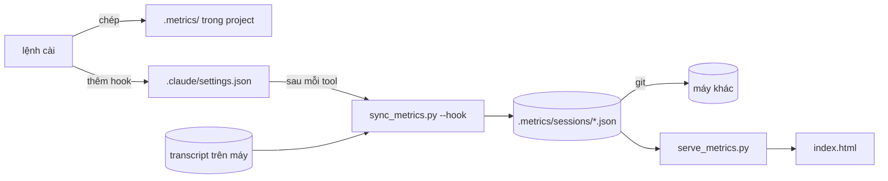

# SPEC — `session-metrics`

## 1. Mục tiêu

Skill cài vào một project cách ghi lại từng session Claude Code chạy trong project đó: mỗi prompt, mỗi lần gọi model
và tool, thời gian, token, subagent, skill. Số liệu đi theo git, nên mở project ở máy nào cũng xem được session của mọi
máy.

Claude Code đã tự ghi mọi thứ vào transcript `~/.claude/projects/<project>/<sessionId>.jsonl`. Transcript có hai chỗ
không dùng được để xem lại:

- Transcript chỉ nằm trên máy chạy session.
- Transcript nặng vì chứa ảnh base64, bản chép SKILL.md, payload hook. Session nặng nhất đo được là 142 MB.

Skill dựng từ transcript một file số liệu gọn cho mỗi session, khoảng 7 % cỡ transcript. File được commit cùng project.

## 2. Feature requirement

Mỗi scope là một nhóm chức năng, chia thành sub-scope. Mỗi phần của mục 3 mở đầu bằng dòng **Scope:** ghi các scope
hay sub-scope nó phục vụ.

SPEC chỉ tả những gì skill đang làm. Yêu cầu nào do việc nào đưa vào, việc nào còn chờ: [PLANS.md](PLANS.md).

- **`F1` Cài vào project**
  - `F1.1` Khi agent chạy lệnh cài ở một project, lệnh cài chép script ghi session, server và trang xem vào `.metrics/`
    của project.
  - `F1.2` Lệnh cài thêm hook gọi script ghi session vào `.claude/settings.json` của project và giữ nguyên các hook
    khác.
  - `F1.3` Khi lệnh cài chạy ở project đã có hook gọi `sync_metrics.py`, lệnh cài thay hook đó tại chỗ và không thêm
    hook trùng.
  - `F1.4` Nếu project chưa có `.metrics/config.json`, thì lệnh cài tạo file đó với giá trị mặc định.
  - `F1.5` Lệnh cài không sửa `.metrics/config.json` và `.metrics/sessions/` đã có.
  - `F1.6` Nếu `.claude/settings.json` không đọc được thành JSON, thì lệnh cài báo lỗi và không ghi file đó.
- **`F2` Ghi session**
  - `F2.1` Khi một session trong project nhận prompt, chạy xong một tool, chờ người dùng, kết thúc lượt hay đóng, hook
    ghi lại file `.metrics/sessions/<sessionId>.json` của session đó.
  - `F2.2` Khi hook gọi script, script chỉ đọc lại transcript của session gọi hook.
  - `F2.3` Khi người dùng chạy script ghi session bằng tay, script đọc lại mọi transcript của project trên máy đang chạy.
  - `F2.4` Script chỉ ghi file của session có transcript trên máy đang chạy và không xoá file session nào.
  - `F2.5` Nếu script lỗi, thì session Claude Code vẫn chạy tiếp và không thấy lỗi.
- **`F3` Nội dung file session**
  - `F3.1` File session giữ prompt, chữ agent trả lời, input và output của tool, subagent lồng dưới dòng `Agent` sinh ra
    nó, token, thời gian và cây skill run.
  - `F3.2` Script thay chuỗi trông giống secret bằng `«redacted»` trước khi ghi.
  - `F3.3` Khi tool `Read` đọc file `.env*`, `*.pem`, `*.key`, `id_rsa*` hay `id_ed25519*`, script bỏ output của lần
    đọc đó.
  - `F3.4` Khi prompt hay kết quả tool có ảnh, script ghi một dòng tả loại và cỡ ảnh thay cho dữ liệu ảnh.
  - `F3.5` Khi Claude Code nạp SKILL.md vào transcript lúc gọi skill, script chỉ ghi tên skill.
  - `F3.6` Với `"content": "numbers"` trong `.metrics/config.json`, script bỏ mọi chữ khỏi file session và giữ số liệu,
    tên tool, tên skill.
  - `F3.7` Với danh sách `stageSkills` trong `.metrics/config.json`, script coi skill trong danh sách là mở chặng mới,
    không phải bước con của skill điều phối đứng trước.
- **`F4` Xem metric**
  - `F4.1` Khi người dùng chạy server, server mở trang xem trong trình duyệt và in địa chỉ trang.
  - `F4.2` Trang xem hiện mọi session trong `.metrics/sessions/`, gồm session do máy khác ghi.
  - `F4.3` Trang xem hiện trạng thái đang chạy, chờ người dùng, đang mở hay đã dừng của session trên máy chạy server.
  - `F4.4` Trong lúc ô "Tự cập nhật" bật, trang xem vẽ lại trong vòng 3 giây sau khi một file session đổi.
  - `F4.5` Nếu cổng đã có tiến trình khác nghe, thì server dùng cổng kế tiếp.
  - `F4.6` Nếu trang xem không gọi được server, thì trang hiện lệnh chạy server.
  - `F4.7` Khi server khởi động, server chạy script ghi session một lượt ở nền.

## 3. Technical design

Ba phần, chạy ở ba chỗ khác nhau:

| Phần | Là gì | Chạy ở đâu | Scope |
| --- | --- | --- | --- |
| **lệnh cài** | `scripts/install.py` | thư mục skill, agent gọi một lần | `F1` |
| **script ghi session** | `metrics/sync_metrics.py`, chép thành `.metrics/sync_metrics.py` | trong project, hook gọi | `F2` `F3` |
| **server và trang xem** | `metrics/serve_metrics.py`, `metrics/index.html`, chép vào `.metrics/` | trong project, người dùng gọi | `F4` |



### 3.1 Thư mục trong project

**Scope:** `F1.1` `F1.4` `F1.5`

```text
<project>/
  .claude/settings.json        thêm 5 hook, giữ hook khác
  .metrics/
    sync_metrics.py            lệnh cài ghi đè
    serve_metrics.py           lệnh cài ghi đè
    index.html                 lệnh cài ghi đè
    config.json                lệnh cài chỉ tạo khi chưa có
    sessions/<sessionId>.json  commit vào git; lệnh cài không đụng
```

Script, server, trang xem nằm trong project, không nằm trong thư mục skill. Clone project ở máy nào thì hook chạy ngay,
máy đó không cần cài skill. Đổi lại, muốn nâng cấp thì chạy lại lệnh cài ở từng project.

Script tìm gốc project bằng thư mục cha của `.metrics/`, nên chạy từ đâu cũng được.

### 3.2 Hook

**Scope:** `F1.2` `F1.3` `F1.6` `F2.1` `F2.5`

| Event | Lệnh | `async` | `timeout` |
| --- | --- | --- | --- |
| `UserPromptSubmit`, `PostToolUse` (matcher `*`), `Notification`, `Stop` | `python3 "$CLAUDE_PROJECT_DIR/.metrics/sync_metrics.py" --hook 2>/dev/null \|\| true` | `true` | 30 |
| `SessionEnd` | `p=$(cat); printf '%s' "$p" \| nohup python3 "$CLAUDE_PROJECT_DIR/.metrics/sync_metrics.py" --hook >/dev/null 2>&1 &` | — | 10 |

- Mọi hook chạy nền và luôn thoát 0, nên script lỗi hay máy thiếu `python3` thì session vẫn chạy.
- `SessionEnd` chạy script tách khỏi Claude Code bằng `nohup … &`, vì Claude Code thoát ngay sau hook này. Lệnh chạy nền
  không còn stdin của hook, nên hook đọc payload trước rồi đưa vào script qua pipe.
- Lệnh cài nhận ra hook của mình bằng chữ `sync_metrics.py` trong lệnh, rồi thay tại chỗ. Khớp theo tên file thì hook
  cũ trỏ `scripts/sync_metrics.py` cũng được nâng cấp. Nếu một event có nhiều hook như vậy, thì lệnh cài giữ hook đầu
  và bỏ các hook sau. Event chưa có thì thêm một nhóm ở cuối mảng của event đó.
- Lệnh cài ghi lại `settings.json` với `indent=2`. File hỏng JSON thì lệnh cài thoát 1 và không ghi.

### 3.3 Script ghi session

**Scope:** `F2.2` `F2.3` `F2.4` `F3.1` `F3.7`

| Lệnh | Làm gì |
| --- | --- |
| `sync_metrics.py --hook` | Đọc payload hook ở stdin, lấy `transcript_path`, chỉ dựng lại session đó. Payload trỏ transcript subagent (`<sessionId>/subagents/agent-*.jsonl`) thì đổi về transcript của session cha. Payload hỏng thì dựng lại cả project. |
| `sync_metrics.py` | Dựng lại mọi `*.jsonl` trong `~/.claude/projects/<đường dẫn project, ký tự lạ thành ->/`. |

Đọc lại cả project 60 session, 495 MB mất 2,1 giây. Đọc một session 142 MB mất 0,7 giây. Vì hook chạy sau mỗi tool, hook
chỉ đọc session gọi nó. `transcript_path` còn đúng cả khi Claude Code mở ở thư mục con của project.

Mỗi session một file. Mỗi máy chỉ ghi file của session có transcript trên máy đó, nên hai máy không sửa cùng một file và
git không conflict. Script không xoá file nào, nên session còn lại sau khi Claude Code dọn transcript cũ. Script chỉ ghi
khi nội dung đổi, ghi ra file tạm rồi rename.

Cấu trúc file session: `sessions` → `turns[]` → `events[]`. Mỗi turn mở bằng một prompt người dùng gõ
(`origin.kind: "human"`). Event là một lượt gọi model, một lần gọi tool, hay một tin chen giữa lượt. Token cộng theo
`message.id`, vì một lượt gọi model ghi thành nhiều record cùng `usage`. Subagent nằm trong field `subagent` của event
`Agent` sinh ra nó, nối qua `toolUseId` trong `agent-<id>.meta.json`.

`skillRuns` là cây các lần gọi skill. Skill gọi bước kế tiếp trong vòng 60 giây cùng prompt là skill điều phối; các run
sau nó là bước con. Chuỗi bước con dừng khi gặp skill điều phối khác hoặc skill có tên trong `stageSkills`.

### 3.4 Lọc nội dung

**Scope:** `F3.2` `F3.3` `F3.4` `F3.5` `F3.6`

| Gặp gì | Ghi gì |
| --- | --- |
| `sk-…`, `gh[pousr]_…`, `AKIA…`, JWT, khối private key | `«redacted»` |
| `KEY=value`, `KEY: value` với tên viết hoa chứa `TOKEN` `SECRET` `PASSWORD` `PASSWD` `API_KEY` `APIKEY` `PRIVATE_KEY`; header `x-…-secret`, `x-…-token`, `x-…-key`, `authorization` | Tên giữ nguyên, giá trị thành `«redacted»` |
| `Read` đọc `.env*`, `*.pem`, `*.key`, `id_rsa*`, `id_ed25519*` | `[bỏ output: file có thể chứa secret]` |
| Khối `image` | `[ảnh <media_type>, <KB> KB]` |
| Prompt bắt đầu bằng `Base directory for this skill: <dir>` | `[nội dung skill <tên thư mục>]` |
| Chuỗi dài | Che trước, cắt sau: 1.500 ký tự, prompt 4.000, tiêu đề 300 |

Mẫu `KEY=value` chỉ bắt tên viết hoa kiểu biến môi trường và bỏ qua giá trị là kiểu dữ liệu hay tham chiếu biến
(`string`, `process.env…`, `${…}`). Mẫu không phân biệt hoa thường bắt 91 chỗ trên 10 session thật, phần lớn che nhầm
code như `PROXY_SECRET: string;`. Mẫu siết chặt bắt đúng secret thật. Đổi lại, key viết thường trong object JS
(`password: 'abc'`) và mật khẩu viết trong câu văn lọt qua.

Ảnh, bản chép SKILL.md và khoảng trắng thụt lề không mang thông tin về việc session làm. Trên 10 session thật, ba phần
này chiếm khoảng 20 % file. File ghi một giá trị mỗi dòng, không thụt lề (`indent=0`), để git vẫn so được từng dòng.

`.metrics/config.json`:

| Key | Giá trị | Mặc định | Tác dụng |
| --- | --- | --- | --- |
| `content` | `"full"` · `"numbers"` | `"full"` | `numbers`: chuỗi `text`, `prompt`, `result`, `label`, `title`, `args`, `description`, `content` thành `""`; `input` thành `{}`; `attachments` thành `[]`. Chuỗi thành `""` chứ không thành `null`, vì trang xem coi prompt `null` là lượt không có prompt. |
| `stageSkills` | mảng tên skill | `[]` | Xem 3.3. |

Cấu hình nằm trong file, không nằm trong cờ lệnh, vì hook và lần chạy tay phải đọc cùng một chỗ. Nếu cờ đặt ở hook, thì
lần chạy tay quên cờ sẽ ghi lại đầy đủ. File thiếu, hỏng hay thiếu key thì script dùng mặc định cho key đó.

### 3.5 Server và trang xem

**Scope:** `F4`

| Request | Trả |
| --- | --- |
| `GET /`, `GET /index.html` | `.metrics/index.html` |
| `GET /api/metrics` | `{project, machine, sessionDir, generatedAt, sessions[]}`. Mỗi session thêm `state`, `pid`. Header `ETag` băm tên, giờ sửa, cỡ mỗi file cộng trạng thái sống. |
| `GET /api/metrics` kèm `If-None-Match` trùng | `304` |
| `GET /favicon.ico` | `204` |

Trang mở bằng `file://` không `fetch` được file khác, và không liệt kê được thư mục. Vì vậy trang cần server đọc
`sessions/*`. Server không sinh file gộp nào, nên git chỉ có `sessions/*`.

`state` lấy từ `~/.claude/sessions/<pid>.json` và `ps`:

| `state` | Điều kiện |
| --- | --- |
| `running` | Tiến trình tên chứa `claude` còn sống, `status: busy` |
| `waiting` | Còn sống, `status: waiting` |
| `idle` | Còn sống, `status: idle` |
| `stopped` | Không còn tiến trình nào mang `pid` đó |

Server chỉ thấy tiến trình trên máy chạy server, nên session của máy khác luôn `stopped`.

Server nghe ở `127.0.0.1`, mặc định cổng 8765. Trước khi mở cổng, server thử kết nối cả `127.0.0.1` lẫn `::1`. macOS cho
mở `127.0.0.1:8765` dù server khác đã nghe `::1:8765`, và trình duyệt gõ `localhost` thì vào `::1` trước. Server in địa
chỉ bằng `127.0.0.1`.

Trang hỏi `/api/metrics` mỗi 3 giây khi ô "Tự cập nhật" bật và tab đang hiện. Trang gửi ETag lần trước, nhận 304 khi
không có gì mới, nên chỉ tải và vẽ lại khi dữ liệu đổi.

## 4. Không thuộc phạm vi

- Windows: server hỏi `ps`, hook viết bằng cú pháp `sh`.
- Gỡ cài.
- Tự commit `.metrics/sessions/`. Người dùng commit cùng việc của mình; chưa commit thì máy khác chưa thấy.
- Gộp nhiều project vào một trang.
- Hook audit và hook `/implement` của spec-lite.
